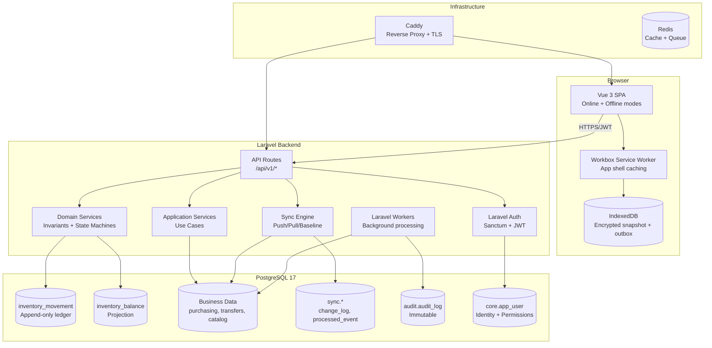

# VaultFlow — Comprehensive Technical Migration Audit

> **Audit date:** 2026-10-12
> **Auditor role:** Senior Software Architect (.NET/Blazor, Laravel, PostgreSQL, Offline-First PWA)
> **Scope:** Full repository inspection of `VaultFlow.slnx` — 9 source projects, 8 test projects, build/CI infrastructure, Docker hosting, and the PostgreSQL 17 inventory ledger.
> **Method:** Static source inspection only. No code was modified, no builds run, no databases touched.

---

## Section 1 — Executive Summary

### Actual current architecture

VaultFlow is a **Clean Architecture** solution on **.NET 10** (`net10.0`, SDK `10.0.301` pinned in `global.json`) with **ASP.NET Core 10** and **EF Core 10**. It runs on **PostgreSQL 17** as the authoritative database, with **SQLite/SQLCipher** for the offline MAUI device store. The solution contains 9 source projects and 8 test projects.

The system has three runtime surfaces:

1. **Online Web Application** (`src/Pos.Web`) — a Blazor Web App using **interactive server render mode** for the owner/admin dashboard. 31 Razor pages under `Components/Pages`. Uses **cookie authentication** and calls the API through a typed `VaultFlowApiClient`. Also hosts the PWA at `/offline/`.
2. **Offline PWA** (`src/Pos.Web.Client`) — a **Blazor WebAssembly** app served under `/offline/`. A single mega-page (`Home.razor`) with sections for overview, purchasing, receiving, inventory, restock, sync queue, and employee preparation. Uses **IndexedDB + WebCrypto (AES-GCM)** for encrypted local storage and a same-origin API gateway (`/offline/api/*`).
3. **MAUI Desktop/Mobile Client** (`src/Pos.Client`) — a **.NET MAUI Blazor Hybrid** app for Windows and Android. Uses encrypted SQLite for local offline storage. **This is marked for retirement** per AGENTS.md scope.

The backend is a single **ASP.NET Core minimal API** (`src/Pos.Api`) with ~150+ endpoints across auth, devices, sync, terminal, catalog, locations, inventory, purchasing, transfers, sales, shifts, returns, customers, receipts, quarantine, administration, notifications, dashboard, reports, and audit. Real-time notifications use **SignalR**.

### Current online web technology

- **Framework:** ASP.NET Core 10 + Blazor (interactive server render mode)
- **UI:** 31 Razor pages, custom CSS design system (`app.css`, `inventory-office.css`, `purchasing.css`, `restock.css`, `web-workflow.css`), Bootstrap 5 CSS available but custom CSS is primary
- **Fonts:** Manrope + DM Sans (OFL licensed, bundled locally as WOFF2)
- **Authentication:** Cookie-based (online web), JWT RS256 (API + PWA)
- **Real-time:** SignalR hub at `/hubs/notifications`
- **Camera scanning:** ZXing WASM (`zxing-wasm` 3.1.5)
- **API client:** Typed `VaultFlowApiClient` with ~80+ methods
- **State management:** Blazor server-side state, `UserSession` scoped service, `NotificationStore` with SignalR

### Current offline PWA technology

- **Framework:** Blazor WebAssembly 10 (`Microsoft.NET.Sdk.BlazorWebAssembly`)
- **Hosting:** Served under `/offline/` by `Pos.Web` (static web asset base path `offline`)
- **Local storage:** IndexedDB (`vaultflow-pwa-v1`) with 4 object stores: `meta`, `profiles`, `data`, `outbox`
- **Encryption:** WebCrypto AES-GCM 256-bit, keys derived via PBKDF2-SHA256 (250,000 iterations) from user password or 8-digit PIN
- **Service worker:** Published worker caches app shell in versioned Cache Storage (`vaultflow-pwa-shell-*`); root service worker provides navigation fallback
- **Sync:** Same-origin gateway (`/offline/api/*`) proxies to API; outbox queue with sequence-ordered events; push/pull sync protocol
- **Offline capabilities:** 3 workflows (purchase draft, receiving count, restock draft) + read-only inventory snapshot + employee provisioning

### How the two builds interact or differ

| Aspect | Online Web (`Pos.Web`) | Offline PWA (`Pos.Web.Client`) |
|---|---|---|
| Rendering | Interactive server (Blazor Server) | WebAssembly (client-side) |
| Authentication | Cookie + JWT for API calls | JWT via same-origin gateway; offline PIN/password unlock |
| Data access | Live API calls | IndexedDB encrypted snapshot |
| Business logic | Server-side via API | Client-side JS + Blazor WASM |
| Features | Full (31 pages) | Limited (3 workflows + read-only inventory) |
| Real-time | SignalR live updates | None; manual sync on reconnect |
| Shared components | `Pos.SharedUI` (scanning, login surface) | `Pos.SharedUI` (login surface), `Pos.Shared` |

**They share:** `Pos.SharedUI` (Razor class library), `Pos.Shared` (wire contracts), the same CSS design tokens (app.css), the same ZXing WASM scanner, and the same backend API (via gateway for PWA).

**They are separate builds:** `Pos.Web` is a server-rendered Blazor app; `Pos.Web.Client` is a separate Blazor WASM project compiled and deployed under `/offline/`. The PWA has its own `index.html`, service worker, and offline JavaScript engine.

### Current backend and database

- **Backend:** ASP.NET Core 10 minimal API with CQRS-lite dispatcher, FluentValidation, SignalR, rate limiting, Serilog
- **Database:** PostgreSQL 17 with 9 schemas (`core`, `catalog`, `inventory`, `purchasing`, `transfers`, `quarantine`, `sales`, `sync`, `audit`)
- **Inventory ledger:** Append-only double-entry `inventory_movement` table with 4-layer immutability enforcement (domain types, EF interceptor, DB triggers, DB roles)
- **Projection:** `inventory_balance` materialized view updated in same transaction
- **Identity:** ASP.NET Core Identity with 600k PBKDF2 iterations, 83 permissions, role-based authorization
- **Sync:** `sync.change_log` (cursor-based feed), `sync.processed_event` (idempotency), `sync.sync_checkpoint`, `sync.sync_failure`

### Whether migration is feasible

**Yes — technically feasible, with significant effort.** The backend business logic is well-structured in Domain and Application layers with clear boundaries. The PostgreSQL schema is standard and Laravel-compatible. The inventory ledger is database-enforced (triggers, constraints) and can be preserved as-is. The authentication system (ASP.NET Identity with PBKDF2) can be replaced by Laravel Sanctum/Breeze with compatible password hashing.

**However**, the offline PWA synchronization protocol is deeply intertwined with the .NET backend's sync engine. The sync protocol contracts (EventId, DeviceSequence, payload hashing, conflict taxonomy) must be precisely preserved or reimplemented. The Blazor WASM PWA's JavaScript offline engine (`offline-store.js`) is framework-agnostic and could theoretically be extracted, but it is tightly coupled to the Blazor WASM startup lifecycle.

### Major migration risks

1. **Inventory ledger integrity** — the 4-layer immutability (domain, EF interceptor, DB triggers, DB roles) must be replicated exactly in Laravel. The DB-level triggers and roles are portable; the application-layer guards must be reimplemented.
2. **Offline sync protocol** — the EventId/deviceSequence/payloadHash idempotency contract, conflict taxonomy, and change-feed cursor mechanism must be preserved precisely.
3. **Authentication migration** — 600k PBKDF2-SHA512 password hashes must verify under Laravel. The format is .NET Identity v3; Laravel's default bcrypt will not verify existing hashes. A custom hasher or migration strategy is required.
4. **Blazor WASM PWA replacement** — the offline PWA is a single-purpose Blazor WASM app. Replacing it with a Vue/React PWA requires reimplementing the IndexedDB encryption layer, sync engine, and all offline workflows.
5. **Business logic parity** — domain invariants, state machines, and validation rules are implemented in C# domain types. These must be reimplemented in PHP with identical behavior.

### Recommended target architecture

**Laravel 12 + Vue 3 (Inertia or API SPA) + PWA with Workbox**, preserving the existing PostgreSQL 17 database with minimal schema changes. The offline PWA should be rebuilt as a Vue 3 SPA with a Workbox service worker, reusing the encrypted IndexedDB + outbox sync pattern. The sync protocol contracts (EventId, DeviceSequence, payloadHash, conflict outcomes) should be preserved as-is, with the Laravel sync engine implementing the same REST contract.

---

## Section 2 — Project Inventory

| Project / Directory | Technology | Responsibility | Active? | Migration Action |
|---|---|---|---|---|
| `src/Pos.Domain` | C# / .NET 10 (no dependencies) | Entities, value objects, enums, domain events, invariants, state machines | Yes | **REWRITE** — reimplement in PHP |
| `src/Pos.Shared` | C# / .NET 10 (no dependencies) | Wire contracts (DTOs), sync envelopes, scanning primitives, barcode types | Yes | **REWRITE** — reimplement as Laravel API resources / TS types |
| `src/Pos.Application` | C# / .NET 10 | Use cases (commands/queries), ports, validators, pipeline behaviors, authorization | Yes | **REWRITE** — reimplement as Laravel services + Form Requests |
| `src/Pos.Infrastructure` | C# / .NET 10 + EF Core 10 + Npgsql + SQLCipher | PostgreSQL/SQLite persistence, EF mappings, identity, sync engine, ledger, migrations | Yes | **REWRITE** — reimplement as Laravel Eloquent + raw SQL; preserve DB triggers/roles |
| `src/Pos.Api` | C# / .NET 10 + ASP.NET Core 10 + SignalR | HTTP surface, JWT auth, authorization, rate limiting, hubs, health checks | Yes | **REWRITE** — reimplement as Laravel API routes |
| `src/Pos.Web` | C# / .NET 10 + Blazor (interactive server) | Owner/admin dashboard (31 pages), cookie auth, SignalR, API client, PWA host | Yes | **REWRITE** — reimplement as Vue/React SPA |
| `src/Pos.Web.Client` | C# / .NET 10 + Blazor WebAssembly | Offline PWA (1 mega-page), IndexedDB encryption, service worker, sync | Yes | **REWRITE** — reimplement as Vue/React PWA |
| `src/Pos.SharedUI` | C# / .NET 10 + Razor Class Library | Shared Razor components: ScanTarget, ScanFeedback, LoginSurface, keyboard wedge | Yes | **RETIRE** — scanning and login UI reimplemented in new frontend |
| `src/Pos.Client` | C# / .NET 10 + MAUI (Android + Windows) | Desktop/mobile POS with encrypted SQLite offline store | Yes (but out of scope) | **RETIRE** — remove per AGENTS.md scope |
| `tools/Pos.DemoData` | C# / .NET 10 console | Seeds a development database with a month of realistic trading | Dev only | **RETIRE** — dev-only utility |
| `tests/Pos.Domain.Tests` | xUnit + FluentAssertions | Domain invariants, state machines, money/quantity tests (378 tests) | Yes | **REWRITE** — port to PHPUnit/Pest |
| `tests/Pos.Application.Tests` | xUnit + FluentAssertions + NSubstitute | Use-case handler tests, pipeline behaviors (247 tests) | Yes | **REWRITE** — port to PHPUnit/Pest |
| `tests/Pos.Infrastructure.Tests` | xUnit + Testcontainers.PostgreSql | EF mappings, ledger guards (Postgres triggers), sync engine, device outbox (245 tests) | Yes | **REWRITE** — port to PHPUnit with Laravel's DB testing |
| `tests/Pos.Api.IntegrationTests` | xUnit + WebApplicationFactory + Testcontainers | HTTP endpoint integration tests (176 tests) | Yes | **REWRITE** — port to Laravel HTTP tests |
| `tests/Pos.Sync.Tests` | xUnit + WebApplicationFactory + Testcontainers | Sync idempotency, ordering, conflicts, retry (21 tests) | Yes | **REWRITE** — critical to port exactly |
| `tests/Pos.Security.Tests` | xUnit + WebApplicationFactory | Auth matrix, tokens, permissions, audit (52 tests) | Yes | **REWRITE** — port to PHPUnit |
| `tests/Pos.Architecture.Tests` | xUnit + NetArchTest.Rules | Layering, ledger isolation, permission catalogue enforcement | Yes | **RETIRE** — architecture rules are .NET-specific |
| `tests/Pos.Shared.Tests` | xUnit + FluentAssertions | Barcode scanning, keyboard wedge, scan intent parsing | Yes | **REWRITE** — port to Jest/Vitest |
| `tests/Pos.Web.Pwa` | Playwright (Node.js/CJS) | Browser E2E: offline workflow, service worker, installability, startup | Yes | **REWRITE** — port to new PWA stack |
| `TestHttpClient/` | C# / .NET 10 console | Standalone HTTP debugging utility | No (orphaned) | **RETIRE** — not referenced anywhere |
| `build/docker/` | Dockerfiles + SQL | API image, Web image, migrator image, DB init scripts, Caddyfiles | Yes | **ADAPT** — create Laravel Dockerfile, preserve SQL |
| `scripts/` | PowerShell | Dev setup, secrets, phone testing, desktop installer | Yes | **ADAPT** — keep dev scripts, remove MAUI-specific |
| `.github/workflows/` | GitHub Actions | CI: build, test, coverage, MAUI build, image publish | Yes | **ADAPT** — replace .NET CI with Laravel/Vue CI |

---

## Section 3 — Detailed Answers

### PART A — Project and System Architecture

---

**Question ID:** A1

**Answer:** The complete technology stack:

| Layer | Technology | Version | Evidence |
|---|---|---|---|
| Runtime | .NET | 10.0 (SDK 10.0.301) | `global.json:3` |
| Language | C# | latest (LangVersion) | `Directory.Build.props:4` |
| Web Framework | ASP.NET Core | 10.0.9 | `Directory.Packages.props:8` |
| UI Framework | Blazor (Server Interactive + WASM) | 10.0.9 | `Directory.Packages.props:16-18` |
| ORM | Entity Framework Core | 10.0.9 | `Directory.Packages.props:28-33` |
| Database Driver | Npgsql.EntityFrameworkCore.PostgreSQL | 10.0.3 | `Directory.Packages.props:33` |
| Database | PostgreSQL | 17-alpine | `compose.yaml:14` |
| Device DB | SQLite + SQLCipher (SQLitePCLRaw) | 2.1.11 | `Directory.Packages.props:89` |
| Validation | FluentValidation | 12.0.0 | `Directory.Packages.props:52-53` |
| Logging | Serilog | 9.0.0 | `Directory.Packages.props:54-58` |
| Real-time | SignalR | 10.0.9 | `Directory.Packages.props:22` |
| API Docs | Scalar.AspNetCore | 2.17.3 | `Directory.Packages.props:15` |
| Testing | xUnit + FluentAssertions + NSubstitute + Testcontainers | 2.9.3 / 7.2.0 / 5.3.0 / 4.6.0 | `Directory.Packages.props:62-70` |
| Mobile | .NET MAUI | 10.0.20 | `Directory.Packages.props:47-48` |
| Frontend JS | Vanilla JS + ZXing WASM | 3.1.5 | `src/Pos.Web/wwwroot/lib/zxing-wasm/` |
| Reverse Proxy | Caddy | 2-alpine | `compose.yaml:110` |
| Container | Docker Compose | — | `compose.yaml` |

**Status:** CONFIRMED

**Migration Impact:** HIGH

**Recommended Action:** Full stack replacement. Laravel 12 + PHP 8.3+ for backend; Vue 3 + TypeScript for frontend.

---

**Question ID:** A2

**Answer:** The solution contains 9 source projects:

| Project | Responsibility | Evidence |
|---|---|---|
| `Pos.Domain` | Entities, value objects, enums, domain events, invariants, state machines. No dependencies. | `src/Pos.Domain/Pos.Domain.csproj:1-16` |
| `Pos.Shared` | Wire contracts (DTOs), sync envelopes, scanning primitives. No dependencies. | `src/Pos.Shared/Pos.Shared.csproj:1-9` |
| `Pos.Application` | Use cases (commands/queries), ports (interfaces), validators, pipeline behaviors, authorization. References Domain + Shared. | `src/Pos.Application/Pos.Application.csproj:1-25` |
| `Pos.Infrastructure` | EF Core (PostgreSQL + SQLite), Identity, sync engine, ledger, migrations, notifications, audit. References Application. | `src/Pos.Infrastructure/Pos.Infrastructure.csproj:1-38` |
| `Pos.Api` | HTTP endpoints, JWT auth, SignalR hubs, rate limiting, health checks, composition root. References Infrastructure. | `src/Pos.Api/Pos.Api.csproj:1-36` |
| `Pos.Web` | Blazor interactive server dashboard (31 pages). References Web.Client, SharedUI, Infrastructure. | `src/Pos.Web/Pos.Web.csproj:1-21` |
| `Pos.Web.Client` | Blazor WASM offline PWA. References SharedUI. | `src/Pos.Web.Client/Pos.Web.Client.csproj:1-25` |
| `Pos.SharedUI` | Razor class library: ScanTarget, ScanFeedback, LoginSurface, keyboard wedge. References Shared. | `src/Pos.SharedUI/Pos.SharedUI.csproj:1-22` |
| `Pos.Client` | .NET MAUI Blazor Hybrid for Windows + Android. References Application, Domain, Infrastructure, Shared, SharedUI. | `src/Pos.Client/Pos.Client.csproj:1-78` |

**Status:** CONFIRMED

**Migration Impact:** HIGH

**Recommended Action:** See project inventory table above.

---

**Question ID:** A3

**Answer:**

| Surface | Project | Hosting | Evidence |
|---|---|---|---|
| Online web application | `src/Pos.Web` | ASP.NET Core on port 5215 (dev) / 8080 (Docker) | `src/Pos.Web/Program.cs:59`, `compose.prod.yaml:12-31` |
| Offline PWA | `src/Pos.Web.Client` | Blazor WASM served under `/offline/` by Pos.Web | `src/Pos.Web.Client/Pos.Web.Client.csproj:9`, `src/Pos.Web/Program.cs:104` |
| Desktop application | `src/Pos.Client` | .NET MAUI on Windows 10.0.19041+ and Android 23+ | `src/Pos.Client/Pos.Client.csproj:4-40` |
| Mobile application | `src/Pos.Client` | Same MAUI project, Android target | `src/Pos.Client/Pos.Client.csproj:4` |
| Shared libraries | `Pos.SharedUI`, `Pos.Shared` | Razor class library + contracts library | `src/Pos.SharedUI/`, `src/Pos.Shared/` |
| Backend API | `src/Pos.Api` | ASP.NET Core on port 5177 (dev) / 8080 (Docker) | `src/Pos.Api/Program.cs`, `compose.yaml:71-107` |

**Status:** CONFIRMED

**Migration Impact:** HIGH

---

**Question ID:** A4

**Answer:** The online web application (`Pos.Web`) is a **Blazor Web App** using **interactive server render mode**:

```csharp
// src/Pos.Web/Program.cs:15-16, 105-106
builder.Services.AddRazorComponents()
    .AddInteractiveServerComponents();
// ...
app.MapRazorComponents<App>()
    .AddInteractiveServerRenderMode();
```

It is NOT Blazor Server (legacy), NOT Blazor WebAssembly (the PWA is separate), and NOT MAUI Blazor Hybrid. It is the .NET 10 unified Blazor Web App model with `AddInteractiveServerRenderMode()`.

The offline PWA (`Pos.Web.Client`) is **Blazor WebAssembly**:

```xml
<!-- src/Pos.Web.Client/Pos.Web.Client.csproj:2 -->
<Project Sdk="Microsoft.NET.Sdk.BlazorWebAssembly">
```

**Status:** CONFIRMED

**Migration Impact:** HIGH

---

**Question ID:** A5

**Answer:** Online and offline experiences are **separate applications with separate compiled builds**, but they share hosting:

- `Pos.Web` is the primary Blazor Web App (server-interactive). It hosts the PWA at `/offline/` via:
  ```csharp
  // src/Pos.Web/Program.cs:104
  app.MapFallbackToFile("/offline/{*path:nonfile}", "offline/index.html");
  ```
- `Pos.Web.Client` is a separate Blazor WASM project that gets compiled into static assets served under `/offline/`. It has its own `index.html`, service worker, manifest, and JavaScript.
- They share the same origin (same domain), the same API (PWA goes through `/offline/api/*` gateway), and some UI components (`Pos.SharedUI`).
- They are NOT two modes of one application. They are independently built and deployed.

**Status:** CONFIRMED

**Migration Impact:** HIGH

---

**Question ID:** A6

**Answer:**

| Aspect | Online Web | Offline PWA |
|---|---|---|
| Build | `dotnet build src/Pos.Web` — server-rendered Blazor | `dotnet build src/Pos.Web.Client` — WASM bundle |
| Config | `Api:BaseAddress` → API URL | Same origin, `/offline/api/*` gateway |
| Routing | Blazor Router with 31 `@page` directives | Blazor Router with 1 mega-page + section variable |
| Hosting | ASP.NET Core app on port 8080 | Static files under `/offline/` served by Pos.Web |
| Updates | Server restart + client reconnection | Service worker update → new cache version → client reload |
| Docker | `Dockerfile.web` → `web` service | Same `Dockerfile.web` (includes WASM assets) |

**Status:** CONFIRMED

**Migration Impact:** MEDIUM

---

**Question ID:** A7

**Answer:**

| Component | Shared? | Details |
|---|---|---|
| Components | Partial | `Pos.SharedUI` (ScanTarget, ScanFeedback, LoginSurface) shared via Razor class library |
| Services | No | Online uses `VaultFlowApiClient` (C#); PWA uses `offline-store.js` (JavaScript) |
| CSS | Partial | `app.css` served to both; PWA has own `offline.css` + `workspace.css` |
| JavaScript | Partial | `camera-scanner.js`, `scan-audio.js` duplicated in both projects' `wwwroot/js/` |
| Models | No | Online uses C# DTOs; PWA uses `OfflineModels.cs` (separate C# models) |
| Authentication | Different | Online: cookie + JWT; PWA: JWT via gateway + offline PIN unlock |
| Business logic | No | Online: server-side API; PWA: client-side JS + Blazor WASM components |
| Backend API | Yes | Same API endpoints; PWA accesses via same-origin gateway |

**Duplicated implementations:**
- `camera-scanner.js` — identical barcode scanner in both `Pos.Web/wwwroot/js/` and `Pos.Web.Client/wwwroot/js/`
- `scan-audio.js` — identical audio feedback in both
- `zxing-wasm/` — identical WASM reader + JS wrapper in both
- `app.css` — referenced by both but PWA has additional offline-specific styles

**Status:** CONFIRMED

**Migration Impact:** MEDIUM

---

**Question ID:** A8

**Answer:** The communication architecture:

```
Browser (Pos.Web) ──HTTPS/cookie──→ ASP.NET Core API (Pos.Api)
       │                              │
       │ SignalR (WebSocket)          │ EF Core
       ↓                              ↓
  NotificationHub              PostgreSQL 17
                                      ↑
Browser (Pos.Web.Client PWA) ──HTTPS/JWT──→ /offline/api/* gateway ──→ Pos.Api
       │
       │ fetch (same-origin)
       ↓
  PwaGateway.cs (server-side proxy) ──→ Pos.Api (internal HttpClient)
       │
       ↓
  IndexedDB (encrypted local storage)
```

Key points:
- Online web uses **cookie authentication** for the Blazor server circuit and **JWT** for API calls
- PWA uses **JWT** through a same-origin gateway (`PwaGateway.cs`) that holds API credentials server-side
- SignalR provides real-time notifications to the online web app only
- The PWA does NOT use SignalR; it relies on `online`/`offline` events and manual sync
- PostgreSQL is the single source of truth; no Redis is used

**Status:** CONFIRMED

**Migration Impact:** HIGH

---

**Question ID:** A9

**Answer:** Dependency map (project references):

```
Pos.Domain          ← (nothing)
Pos.Shared          ← (nothing)
Pos.Application     ← Pos.Domain, Pos.Shared
Pos.Infrastructure  ← Pos.Application, Pos.Domain, Pos.Shared
Pos.Api             ← Pos.Application, Pos.Infrastructure, Pos.Domain, Pos.Shared
Pos.SharedUI        ← Pos.Shared
Pos.Web             ← Pos.Web.Client, Pos.SharedUI, Pos.Infrastructure
Pos.Web.Client      ← Pos.SharedUI
Pos.Client          ← Pos.Application, Pos.Domain, Pos.Infrastructure, Pos.Shared, Pos.SharedUI
```

Enforced by `Pos.Architecture.Tests` (NetArchTest.Rules). `Pos.Web` and `Pos.Client` never reference `Pos.Api` directly.

**Status:** CONFIRMED

**Migration Impact:** MEDIUM

---

**Question ID:** A10

**Answer:**

| Component | Can retire? | Still required by web? |
|---|---|---|
| `Pos.Client` (MAUI) | Yes — safe to retire | No — separate app, not referenced by Pos.Web |
| `Pos.SharedUI` | Yes — reimplement in new frontend | No — Blazor-specific |
| `TestHttpClient/` | Yes — orphaned, unreferenced | No |
| `tools/Pos.DemoData/` | Yes — dev only | No |
| `Pos.Domain` | No — contains business rules to preserve | Yes — logic must be ported |
| `Pos.Application` | No — contains use cases to preserve | Yes — logic must be ported |
| `Pos.Infrastructure` | No — contains sync engine, ledger, identity | Yes — logic must be ported |
| `Pos.Api` | No — contains endpoint contracts | Yes — logic must be ported |
| `Pos.Web` | Yes — rewrite in new frontend | — |
| `Pos.Web.Client` | Yes — rewrite in new PWA | — |

**Status:** CONFIRMED

**Migration Impact:** HIGH

---

### PART B — Online Web Application

---

**Question ID:** B1

**Answer:** Every implemented page in `src/Pos.Web/Components/Pages/` (31 pages):

| # | Page | Route | Purpose |
|---|---|---|---|
| 1 | `Home.razor` | `/` | Owner/admin dashboard: KPIs, charts, activity feed, exceptions |
| 2 | `Login.razor` | `/login` | Sign-in with 2FA, location picker, offline enrolment |
| 3 | `Notifications.razor` | `/notifications` | Notification feed with filters, live updates |
| 4 | `Stores.razor` | `/stores` | Store movement comparison, charts |
| 5 | `Sales.razor` | `/sales` | Sales ledger search with pagination |
| 6 | `SaleDetail.razor` | `/sales/{Id:guid}` | Sale detail, receipt viewing/printing |
| 7 | `ReturnDetail.razor` | `/returns/{Id:guid}` | Return inspection, disposition workflow |
| 8 | `ProductAnalytics.razor` | `/analytics/products` | Best/worst sellers |
| 9 | `InventoryCounts.razor` | `/inventory/counts` | Stock count list, open count form |
| 10 | `InventoryCountDetail.razor` | `/inventory/counts/{CountId:guid}` | Count sheet, scan-to-count, variance, submit/approve |
| 11 | `InventoryExceptions.razor` | `/inventory/exceptions` | Negative-stock attempts dashboard |
| 12 | `InventoryTimeline.razor` | `/inventory/timeline/{DocumentType}/{DocumentId:guid}` | Movement chain trace |
| 13 | `Transfers.razor` | `/transfers` | Transfer list, create form |
| 14 | `TransferDetail.razor` | `/transfers/{TransferId:guid}` | Full transfer workflow (submit/review/approve/pick/dispatch/receive/verify) |
| 15 | `RestockRequests.razor` | `/restock` | Store restock request form |
| 16 | `RestockApprovals.razor` | `/restock/approvals` | Owner approval list |
| 17 | `RestockFulfillment.razor` | `/restock/fulfillment` | Warehouse fulfillment list |
| 18 | `Reports.razor` | `/reports` | Daily operations report |
| 19 | `PurchaseOrders.razor` | `/purchasing` | Purchase order list |
| 20 | `PurchaseOrderNew.razor` | `/purchasing/new` | Create PO with scan-to-add, custom products |
| 21 | `PurchaseOrderDetail.razor` | `/purchasing/{OrderId:guid}` | PO detail, receiving, approval workflow |
| 22 | `PeopleRoles.razor` | `/admin/users` | User + role administration (4-step wizard) |
| 23 | `Devices.razor` | `/admin/devices` | Device fleet management |
| 24 | `AuditLog.razor` | `/admin/audit` | Activity log with filters |
| 25 | `SyncFailures.razor` | `/sync/failures` | Sync failure review |
| 26 | `StoreInventory.razor` | `/inventory/stock` | Stock levels browser, sortable/filterable |
| 27 | `GoodsReceiving.razor` | `/receiving` | Delivery list |
| 28 | `GoodsReceivingDetail.razor` | `/receiving/{OrderId:guid}` | Record delivery with scan-to-count |
| 29 | `Locations.razor` | `/admin/locations` | Location administration |
| 30 | `Error.razor` | `/Error` | Generic error page |
| 31 | `NotFound.razor` | `/not-found` | 404 page |

**Status:** CONFIRMED

**Migration Impact:** HIGH

---

**Question ID:** B2

**Answer:** The UI architecture:

- **Layout:** `MainLayout.razor` — sidebar (`NavMenu`), top-row with breadcrumb (`PageTrail`), notification bell, operator chip, tabbar (up to 4 permission-gated tabs), `ScanFeedback`, offline-readiness banner, `#blazor-error-ui`
- **Routing:** Blazor Router with `@page` directives on each page; `NavMenu.razor` with permission-gated links
- **State management:** Blazor server-side state (circuit-scoped); `UserSession` scoped service holds `SignInResponse`; `NotificationStore` with SignalR live connection
- **Reusable components:** `CameraScanner` (ZXing WASM), `WorkflowPrintButton`, `WorkflowReceipt`, `ScanTarget`, `ScanFeedback` (from SharedUI)
- **Modals:** `ReconnectModal.razor` with reconnect logic
- **Forms:** Blazor forms with `@bind`, FluentValidation-style validation via API responses
- **Tables:** Custom HTML tables with sorting/filtering/pagination in `@code` blocks
- **Notifications:** `NotificationStore` via SignalR + durable `Notification` rows
- **Navigation:** `NavMenu.razor` sidebar with permission-gated groups; `PageTrail` breadcrumb service

**Status:** CONFIRMED

**Migration Impact:** HIGH

---

**Question ID:** B3

**Answer:**

| Asset | Reusable in Laravel? | Details |
|---|---|---|
| CSS | Partial | `app.css` is a custom design system (~design tokens, components). Could be extracted to SCSS/CSS for Vue. `inventory-office.css`, `purchasing.css`, `restock.css`, `web-workflow.css` are page-specific |
| Design tokens | Yes | CSS custom properties for colors, spacing, typography |
| Fonts | Yes | Manrope + DM Sans WOFF2 (OFL licensed) in `wwwroot/fonts/` |
| Icons | Partial | `AppIcon.razor` has inline SVGs (30+ icons) — extractable; `icons/` has PNG icons |
| Images | Yes | `icons/icon-192.png`, `icon-512.png`, `icon-maskable-512.png`, `favicon.png` |
| Bootstrap CSS | Yes but unnecessary | `wwwroot/lib/bootstrap/dist/css/` — available but custom CSS is primary |
| ZXing WASM | Yes | `wwwroot/lib/zxing-wasm/` — framework-agnostic WASM + JS |

**Status:** CONFIRMED

**Migration Impact:** LOW

---

**Question ID:** B4

**Answer:** Operations that call the backend API (via `VaultFlowApiClient`):

The `VaultFlowApiClient` has ~80+ methods. Major request flows:

| Flow | Endpoints | Client Method |
|---|---|---|
| Authentication | `POST /api/v1/auth/login` | `SignInAsync` |
| Notifications | `GET /api/v1/notifications`, `POST .../read`, `POST .../read-all` | `GetNotificationsAsync`, etc. |
| Dashboard | `GET /api/v1/dashboard/*` | `GetStorePerformanceAsync`, etc. |
| Sales | `GET /api/v1/sales`, `GET /api/v1/sales/{id}` | `SearchSalesAsync`, `GetSaleAsync` |
| Inventory | `GET /api/v1/inventory/stock-levels`, `GET/POST /api/v1/inventory/counts/*` | `GetStockLevelsAsync`, etc. |
| Transfers | `GET/POST /api/v1/transfers/*` | `GetTransfersAsync`, etc. |
| Purchasing | `GET/POST /api/v1/purchasing/*` | `GetPurchaseOrdersAsync`, etc. |
| Products | `GET/POST /api/v1/catalog/*` | `GetProductsAsync`, etc. |
| Users/Roles | `GET/POST/PUT /api/v1/users/*`, `GET/PUT /api/v1/roles/*` | `GetUsersAsync`, etc. |
| Devices | `GET/POST /api/v1/devices/*` | `GetDevicesAsync`, etc. |
| Audit | `GET /api/v1/audit` | `GetAuditLogAsync` |
| Quarantine | `GET/POST /api/v1/quarantine/*` | `CreateQuarantineIncidentAsync` |
| Reports | `GET /api/v1/reports/daily-sales` | `GetDailySalesReportAsync` |

**Status:** CONFIRMED

**Migration Impact:** HIGH

---

**Question ID:** B5

**Answer:** Operations with business logic in the frontend:

| Page | Logic in Frontend | Should Be |
|---|---|---|
| `Home.razor` | Chart geometry (monotone cubic Bézier), KPI calculations, sparkline paths | Presentation logic only; data from API |
| `TransferDetail.razor` | Full workflow state machine, timeline building, pick/receive row construction | Presentation + orchestration; server validates |
| `PurchaseOrderDetail.razor` | Receiving panel, quarantine line handling | Presentation + orchestration |
| `StoreInventory.razor` | Sorting, filtering, pagination | Presentation logic |
| `PeopleRoles.razor` | User/role CRUD, override management, permission editor | Presentation + orchestration |

**Key finding:** The frontend is primarily a **presentation layer** that calls API endpoints. Business logic (validation, state transitions, ledger posting) is server-side. The frontend does contain presentation logic (sorting, filtering, chart geometry) that would need to be reimplemented in the new frontend framework.

**Status:** CONFIRMED

**Migration Impact:** MEDIUM

---

**Question ID:** B6

**Answer:** Real-time features:

- **SignalR hub** at `/hubs/notifications` (`NotificationHub.cs`)
- **Online web only** — `NotificationStore.cs` connects via `HubConnectionBuilder`
- **Events:** `notificationReceived` (new notification), `inventoryChanged` (stock movement at location)
- **Groups:** `notifications:global`, `notifications:all-locations`, `notifications:user:{userId}`, `notifications:location:{locationId}`
- **Reconnect:** `WithAutomaticReconnect()`
- **PWA does NOT use SignalR** — relies on `online`/`offline` events and manual sync

**Status:** CONFIRMED

**Migration Impact:** MEDIUM

---

**Question ID:** B7

**Answer:** Advanced UI interactions:

| Feature | Implementation | Pages |
|---|---|---|
| Virtualized tables | No — standard paginated tables | Sales, Audit, Inventory |
| Drag-and-drop | No | — |
| Barcode scanning | ZXing WASM + keyboard wedge | InventoryCountDetail, PurchaseOrderNew, TransferDetail, GoodsReceivingDetail |
| Camera scanning | `CameraScanner.razor` with camera API | Same as above |
| Keyboard shortcuts | Partial — tab navigation, permission-gated tabs | MainLayout |
| Printing | `WorkflowPrintButton` → `receipt-print.js` → print window | SaleDetail, TransferDetail, PurchaseOrderDetail |
| Complex dynamic forms | Blazor forms with `@bind`, conditional rendering | TransferDetail, PurchaseOrderDetail, PeopleRoles |
| Charts | Inline SVG with monotone cubic Bézier interpolation | Home, Stores, Reports |
| Live updates | SignalR `inventoryChanged` → `RefreshThrottle` (2s) | Home, StoreInventory |

**Status:** CONFIRMED

**Migration Impact:** MEDIUM

---

**Question ID:** B8

**Answer:** UI behaviors that depend specifically on Blazor/.NET:

| Behavior | Blazor Dependency | Replacement Needed |
|---|---|---|
| Component lifecycle (`OnInitializedAsync`, `OnParametersSet`) | Blazor | Vue/React lifecycle hooks |
| `@bind` two-way data binding | Blazor | Vue `v-model` / React `useState` |
| `@code` blocks with C# | Blazor | Vue `<script setup>` / React components |
| `AuthenticationStateProvider` | Blazor | Vue/React auth store (Pinia/Redux) |
| `CascadingAuthenticationState` | Blazor | Vue/React context/provider |
| `NavigationManager` | Blazor Router | Vue Router / React Router |
| `IJSRuntime` interop | Blazor | Direct JS API calls |
| `@onclick`, `@onsubmit` | Blazor event handlers | Vue `@click` / React `onClick` |
| CSS isolation (`.razor.css`) | Blazor scoped CSS | CSS Modules / Tailwind |
| `@inject` dependency injection | Blazor DI | Vue provide/inject / React context |
| SignalR client | `Microsoft.AspNetCore.SignalR.Client` | `@microsoft/signalr` npm package |

**Status:** CONFIRMED

**Migration Impact:** HIGH

---

**Question ID:** B9

**Answer:** Error and edge-case handling:

| Scenario | Handling | Evidence |
|---|---|---|
| Loading states | `busy` flag with activity text; `RefreshThrottle` for debounced refresh | `RefreshThrottle.cs` |
| Validation errors | API returns RFC 9457 ProblemDetails; displayed in page | `Pos.Api/Program.cs` |
| Connectivity failures | `ReconnectModal.razor` with reconnection logic; SignalR auto-reconnect | `ReconnectModal.razor` |
| Authorization failures | API returns 403; `UserSession.HasPermission` hides UI elements | `UserSession.cs` |
| Concurrent edits | Optimistic concurrency via `xmin` (Postgres) / `rowversion` (SQLite); `ConcurrencyConflictException` | `Pos.Infrastructure/Inventory/InventoryLedger.cs` |
| Offline (PWA) | `offline-store.js` queues events; `OnlineFeatureLink` shows "Needs Wi-Fi" | `Pos.Web.Client/Components/OnlineFeatureLink.razor` |

**Status:** CONFIRMED

**Migration Impact:** MEDIUM

---

**Question ID:** B10

**Answer:** UI components that could be consolidated:

| Current | Issue | Recommendation |
|---|---|---|
| Two receiving screens (`PurchaseOrderDetail` + `GoodsReceivingDetail`) | Different fields and safeguards; Owner-only vs receiving staff | Consolidate into one form with role-based fields |
| Restock creation in 3 places (`RestockRequests`, `StoreInventory`, `Transfers`) | Separate forms with different behaviors | Unify into one restock flow |
| `Home.razor` + `Stores.razor` | Overlapping KPIs and charts | Could be combined into one dashboard |
| `Sales.razor` + `SaleDetail.razor` | — | Keep separate (list + detail is fine) |

**Status:** CONFIRMED

**Migration Impact:** LOW

---

### PART C — Offline PWA Architecture

---

**Question ID:** C1

**Answer:** The offline PWA is powered by **Blazor WebAssembly**:

```xml
<!-- src/Pos.Web.Client/Pos.Web.Client.csproj:2 -->
<Project Sdk="Microsoft.NET.Sdk.BlazorWebAssembly">
```

It is NOT a JavaScript/TypeScript framework. It is a .NET WebAssembly app that runs in the browser. However, the offline storage and sync logic is implemented in **vanilla JavaScript** (`offline-store.js`) that is invoked via Blazor's JS interop.

**Status:** CONFIRMED

**Migration Impact:** HIGH

---

**Question ID:** C2

**Answer:** The offline PWA source code is at `src/Pos.Web.Client/`:

- **Build:** `dotnet build src/Pos.Web.Client` produces a Blazor WASM bundle
- **Deployment:** The WASM assets are served under `/offline/` by `Pos.Web` (the host)
- **Entry point:** `src/Pos.Web.Client/wwwroot/index.html` — loads Blazor WASM, service worker, and offline JS
- **Fallback route:** `app.MapFallbackToFile("/offline/{*path:nonfile}", "offline/index.html")` in `Pos.Web/Program.cs:104`
- **Docker:** `Dockerfile.web` builds both `Pos.Web` and `Pos.Web.Client`

**Status:** CONFIRMED

**Migration Impact:** HIGH

---

**Question ID:** C3

**Answer:** Two service workers exist:

**1. Root service worker** (`src/Pos.Web/wwwroot/service-worker.js`):
- Registered by `root-pwa-register.js`
- Caches the PWA app shell in versioned Cache Storage (`vaultflow-root-shell-{version}`)
- Serves navigation fallback for supported routes when offline
- Routes cached: `/login`, `/`, `/purchasing`, `/receiving`, `/inventory/stock`, `/restock`, `/stores`, `/sync`, `/team`, `/offline`, `/offline/`
- Validates critical startup files (HTML, JS) after download
- Deletes old cache versions on activation
- Responds to `VAULTFLOW_CACHE_STATUS` and `VAULTFLOW_CACHE_REPAIR` messages

**2. Published client worker** (`src/Pos.Web.Client/wwwroot/service-worker.published.js`):
- Upgrade path for installations that used the former `/offline/` worker
- Caches PWA shell assets in `vaultflow-pwa-shell-*` caches
- Serves cached responses for `/offline/` paths when fetch fails
- Claims clients after activation

**3. Development worker** (`src/Pos.Web.Client/wwwroot/service-worker.js`):
- Empty — always fetches from network, no caching (for development)

**Status:** CONFIRMED

**Migration Impact:** HIGH

---

**Question ID:** C4

**Answer:** How the application remains operational without internet:

1. **Service worker** caches the entire Blazor WASM app shell (DLLs, WASM, JS, CSS, fonts) in Cache Storage
2. **IndexedDB** (`vaultflow-pwa-v1`) stores encrypted snapshots of:
   - `meta` — device info, sequence counter, cursor positions
   - `profiles` — employee profiles with encrypted snapshots
   - `data` — encrypted working forms, snapshots
   - `outbox` — pending sync events
3. **Blazor WASM** runs entirely in the browser after initial load
4. **Offline JS** (`offline-store.js`) manages IndexedDB, encryption, and sync queue
5. **Same-origin API** (`/offline/api/*`) is proxied by `PwaGateway.cs` — but this requires the web server to be reachable. When fully offline, the PWA works from cached data only

**Required locally available resources:**
- Blazor WASM runtime + app DLLs (cached by service worker)
- `app.css`, fonts, icons (cached)
- `offline-store.js`, `pwa-boot.js`, `camera-scanner.js`, `scan-audio.js` (cached)
- `zxing_reader.wasm` + `reader.js` (cached)
- IndexedDB database with encrypted snapshot

**Status:** CONFIRMED

**Migration Impact:** HIGH

---

**Question ID:** C5

**Answer:** Browser storage technologies:

| Technology | Used | Purpose |
|---|---|---|
| **IndexedDB** | Yes | Primary local storage: `vaultflow-pwa-v1` database with 4 object stores (`meta`, `profiles`, `data`, `outbox`) |
| **Cache Storage** | Yes | Service worker caches app shell assets |
| **localStorage** | No | Not used |
| **Session Storage** | No | Not used |
| **OPFS** | No | Not used |
| **SQLite/WASM** | No | Not used in the PWA (used in MAUI client) |

**Status:** CONFIRMED

**Migration Impact:** MEDIUM

---

**Question ID:** C6

**Answer:** SQLite is NOT used in the PWA. The PWA uses **IndexedDB** exclusively.

SQLite/SQLCipher is used only in the **MAUI client** (`Pos.Client`):
- `PosDeviceDbContext` with SQLCipher encryption
- Key stored in platform secure store (DPAPI/Windows Credential Locker, Android Keystore)
- Applied as raw 256-bit key (no passphrase derivation)

**Status:** CONFIRMED

**Migration Impact:** LOW (for PWA); HIGH (for MAUI retirement)

---

**Question ID:** C7

**Answer:** Local data is encrypted using **WebCrypto API**:

| Aspect | Implementation | Evidence |
|---|---|---|
| Algorithm | AES-GCM 256-bit | `offline-store.js:54-55` |
| Key derivation | PBKDF2-SHA256, 250,000 iterations | `offline-store.js:54` |
| Salt | 16 random bytes per profile, stored in profile | `offline-store.js:201` |
| IV | 12 random bytes per encryption operation | `offline-store.js:59` |
| Key storage | Derived from password/PIN at unlock; held in memory only (`active.key`) | `offline-store.js:66, 166-177` |
| Verifier | Encrypted scope string stored in profile to verify password correctness | `offline-store.js:206` |
| Re-wrap | When password changes, all data is decrypted and re-encrypted with new key | `offline-store.js:225-244` |
| Rotation | New salt generated on re-wrap; old key discarded | `offline-store.js:232-234` |

**Status:** CONFIRMED

**Migration Impact:** MEDIUM

---

**Question ID:** C8

**Answer:** Features available offline:

| Feature | Offline Status | Details |
|---|---|---|
| Dashboard (overview) | READ-ONLY | Shows downloaded snapshot KPIs |
| Stock levels | READ-ONLY | Downloaded inventory snapshot |
| Purchase order draft | FULL | Create draft, save encrypted, queue for sync |
| Goods receiving count | FULL | Record counts, save encrypted, queue for sync |
| Restock request draft | FULL | Create request, save encrypted, queue for sync |
| Pending work / sync queue | FULL | View outbox, trigger sync |
| Offline employee provisioning | FULL | Admin prepares employee profiles with PINs |
| Stock counts | UNAVAILABLE | "Needs Wi-Fi" link |
| Transfers | UNAVAILABLE | "Needs Wi-Fi" link |
| Restock approvals | UNAVAILABLE | "Needs Wi-Fi" link |
| Restock fulfillment | UNAVAILABLE | "Needs Wi-Fi" link |
| Sales ledger | UNAVAILABLE | "Needs Wi-Fi" link |
| Returns | UNAVAILABLE | "Needs Wi-Fi" link |
| Product analytics | UNAVAILABLE | "Needs Wi-Fi" link |
| Store movement | UNAVAILABLE | "Needs Wi-Fi" link |
| Daily reports | UNAVAILABLE | "Needs Wi-Fi" link |
| Notifications | UNAVAILABLE | "Needs Wi-Fi" link |
| People & roles | UNAVAILABLE | "Needs Wi-Fi" link |
| Devices | UNAVAILABLE | "Needs Wi-Fi" link |
| Locations | UNAVAILABLE | "Needs Wi-Fi" link |
| Audit log | UNAVAILABLE | "Needs Wi-Fi" link |
| Sync failures | UNAVAILABLE | "Needs Wi-Fi" link |

**Status:** CONFIRMED

**Migration Impact:** HIGH

---

**Question ID:** C9

**Answer:** Features that appear offline-capable but require network:

| Feature | Why It Requires Network |
|---|---|
| Notifications (bell icon) | Shows "Needs Wi-Fi" badge; clicking redirects to online app |
| Sales ledger | `OnlineFeatureLink` component redirects to `/sales` when connected |
| Stock counts | `OnlineFeatureLink` redirects to `/inventory/counts` |
| Transfers | `OnlineFeatureLink` redirects to `/transfers` |
| Admin functions | All `OnlineFeatureLink` components |

The PWA uses `OnlineFeatureLink.razor` which shows the link when connected and a "Needs Wi-Fi" badge when offline. When offline, these features are not accessible.

**Status:** CONFIRMED

**Migration Impact:** MEDIUM

---

**Question ID:** C10

**Answer:** Offline authentication and user verification:

1. **Device enrolment:** One-time enrolment code from admin. Device generates ECDSA P-256 keypair, sends public key thumbprint to server. Server returns `deviceId` + `locationId`. Device stores keypair in IndexedDB.

2. **Online sign-in:** User enters username/password → `offline-store.js:login()` → calls `/offline/api/login` → `PwaGateway.cs` proxies to `/api/v1/auth/login` → verifies device/location → returns `SignInResponse` with JWT + user info.

3. **Profile creation:** On first login, a profile is created with:
   - Random 16-byte salt
   - PBKDF2-derived key from password
   - Encrypted verifier (scope string)
   - Encrypted snapshot of server data
   - Stored in IndexedDB

4. **Offline unlock:** User selects profile → enters password or 8-digit PIN → key derived → verifier decrypted → snapshot loaded. Profile expires after 7 days (`maxOfflineAge`).

5. **Employee provisioning:** Admin can prepare additional employees with 8-digit PINs. Each gets their own encrypted profile + snapshot.

**Status:** CONFIRMED

**Migration Impact:** HIGH

---

**Question ID:** C11

**Answer:** Token expiry, account changes, and permission changes while offline:

| Scenario | Handling |
|---|---|
| Access token expires | PWA attempts refresh via `/offline/api/*` gateway. If offline, sync fails and events stay queued. |
| Account disabled | Server rejects at next sync. PWA cannot detect until online. |
| Permissions change | Server re-validates at sync time. Cached permissions are an upper bound only. |
| User switches accounts | Each account has a separate encrypted profile. User locks current profile and unlocks another. |
| Profile expires (7 days) | `unlock()` checks `lastOnlineUtc` against `maxOfflineAge`. If expired, shows "Offline unlock expired" and directs to online sign-in. |
| Device revoked | Server returns 403 with `wipe-local-cache` directive at next sync. PWA purges caches but retains outbox. |

**Status:** CONFIRMED

**Migration Impact:** HIGH

---

**Question ID:** C12

**Answer:** Local data initialization, caching, refreshing, and scoping:

- **Initialization:** Device enrolment creates the device record. First login creates the profile + downloads snapshot.
- **Caching:** `download()` fetches `/offline/api/snapshot` → `PwaGateway.cs` aggregates baseline + catalog + stock + orders → seals with profile key → stores in IndexedDB.
- **Refreshing:** `synchronize()` pushes outbox events → pulls change feed → if changes detected, calls `download()` to refresh snapshot.
- **Scoping:** All data is scoped to `{userId}:{locationId}` (the profile scope). Outbox events are filtered by scope. Snapshots are per-employee-per-location.

**Status:** CONFIRMED

**Migration Impact:** MEDIUM

---

**Question ID:** C13

**Answer:** Connectivity determination:

- The PWA uses `navigator.onLine` as a primary indicator
- `offline-store.js:watchLifecycle()` listens to `online` and `offline` events
- `assertOnlineIdentity()` calls `/offline/api/me` to verify the session is still valid before syncing
- `pwa-boot.js` monitors service worker readiness and shows warnings when offline
- The PWA does NOT distinguish between "browser says online" and "backend actually reachable" — it attempts the API call and handles failure

**Status:** CONFIRMED

**Migration Impact:** LOW

---

**Question ID:** C14

**Answer:** Mid-operation connectivity loss:

| Scenario | Handling |
|---|---|
| Sync push fails | Event stays in `Saved on device` status; retry on next sync |
| Sync pull fails | Cursor not advanced; pending events intact |
| Snapshot download fails | Existing snapshot preserved; warning shown |
| API call fails during login | Error shown; user can retry |
| Quota exceeded | `queue()` throws `QuotaExceededError`; operation not queued; user warned to free space |

**Status:** CONFIRMED

**Migration Impact:** MEDIUM

---

**Question ID:** C15

**Answer:** Service worker upgrades, stale caches, schema upgrades, version compatibility:

| Scenario | Handling |
|---|---|
| Service worker update | `skipWaiting()` + `clients.claim()` on install/activate. Old cache versions deleted. |
| Stale cached assets | Versioned cache names (`vaultflow-root-shell-{version}`). Old versions deleted on activation. |
| Schema upgrades | IndexedDB `onupgradeneeded` creates new object stores. Currently version 1 only. |
| Frontend/backend version mismatch | Not explicitly handled. API errors surface as sync failures. |
| Cache repair | `VAULTFLOW_CACHE_REPAIR` message triggers `downloadShell()` to re-download. |

**Status:** CONFIRMED

**Migration Impact:** MEDIUM

---

**Question ID:** C16

**Answer:** Unsynchronized records if browser storage is cleared:

- **All local data is lost** if browser storage is cleared (IndexedDB, Cache Storage)
- **Outbox events are lost** — pending sync events cannot be recovered
- **Server data is safe** — the authoritative data is in PostgreSQL
- **Recovery:** User must re-enrol the device, sign in online, and download a fresh snapshot
- **Warning:** The PWA shows "If browser data was cleared, work saved only on this device may have been lost" in multiple places

**Status:** CONFIRMED

**Migration Impact:** HIGH

---

**Question ID:** C17

**Answer:** Offline components reusable after removing .NET:

| Component | Reusable? | Notes |
|---|---|---|
| `offline-store.js` | Partial | Framework-agnostic JS but tightly coupled to Blazor JS interop calls. Would need adapter layer. |
| `pwa-boot.js` | Partial | Service worker registration is generic; Blazor-specific startup logic would be replaced |
| `camera-scanner.js` | Yes | Framework-agnostic ZXing WASM wrapper |
| `scan-audio.js` | Yes | Framework-agnostic audio feedback |
| `zxing-wasm/` | Yes | Framework-agnostic WASM reader |
| `service-worker.published.js` | Partial | Generic caching strategy; Blazor-specific asset list would change |
| `manifest.webmanifest` | Yes | Standard PWA manifest |
| CSS (`offline.css`, `workspace.css`) | Yes | Standard CSS |
| `OfflineModels.cs` | No | C# models; would need TypeScript equivalents |
| Sync protocol contracts | Yes | The REST API contract (EventId, DeviceSequence, eventType, payload) is framework-agnostic |

**Status:** CONFIRMED

**Migration Impact:** MEDIUM

---

**Question ID:** C18

**Answer:** Could one shared frontend support both online and offline modes?

**Yes, technically feasible**, with significant constraints:

**Current architecture:** Two separate Blazor apps (Server + WASM) with different rendering models, different data access patterns, and different feature sets.

**Unified approach:** A single **Vue 3 SPA** (or React) that:
- Runs in the browser for both online and offline modes
- Uses a service worker (Workbox) for offline caching
- Uses IndexedDB + WebCrypto for encrypted local storage (reusing the `offline-store.js` pattern)
- Detects connectivity and switches between "online mode" (live API calls) and "offline mode" (queued operations)
- Shares all components between modes

**Constraints:**
1. The offline feature set is much smaller (3 workflows + read-only inventory vs 31 pages). A unified frontend would need to handle both the full feature set and the restricted offline set.
2. The sync engine must be reimplemented in JavaScript/TypeScript (the current C# sync engine is server-side only; the PWA sync is already in JS).
3. The service worker caching strategy must be redesigned for a Vue SPA.
4. The encryption layer (`offline-store.js`) can be largely reused.

**Recommendation:** A unified Vue 3 SPA with a Workbox service worker is the recommended target architecture. This eliminates the dual-build complexity and provides a consistent user experience.

**Status:** CONFIRMED

**Migration Impact:** HIGH

---

### PART D — Synchronization Engine

---

**Question ID:** D1

**Answer:** The offline-to-online synchronization process, step by step:

```
1. User creates offline operation (purchase draft, receiving count, restock request)
2. offline-store.js:queue() generates EventId (UUID), seals payload with AES-GCM
3. Event stored in IndexedDB 'outbox' with sequence number (meta store counter)
4. User triggers sync (manual or on reconnect)
5. offline-store.js:synchronize() iterates outbox in sequence order
6. For each event:
   a. Mark status 'Syncing'
   b. POST /offline/api/push → PwaGateway.cs → POST /api/v1/sync/push
   c. Server: SyncPushService.PushAsync()
      - Verify device binding (deviceId matches token)
      - Verify device is operational
      - For each event in sequence order:
        i. Check idempotency by EventId in sync.processed_event
        ii. Check device sequence continuity
        iii. Verify payload hash (SHA-256)
        iv. Re-authorize user (current permissions)
        v. Validate against current server state
        vi. Apply business effect (replay handler)
        vii. Record outcome in sync.processed_event
        viii. Write audit log
        ix. Advance checkpoint
   d. Client receives result per event
   e. Update local status (Confirmed/Conflict/Needs review/Saved on device)
7. After push, client pulls change feed:
   a. GET /offline/api/pull?cursor=N → PwaGateway → GET /api/v1/sync/pull
   b. Server returns changes since cursor (max 500)
   c. Client applies changes locally
   d. Advance cursor
8. If changes detected, download fresh snapshot
```

**Evidence:** `offline-store.js:485-535`, `PwaGateway.cs:312-344`, `SyncPushService.cs:35-80`

**Status:** CONFIRMED

**Migration Impact:** CRITICAL

---

**Question ID:** D2

**Answer:** Pending offline operations are stored in:

**Client-side (PWA):**
- IndexedDB `outbox` object store (`offline-store.js:16-18`)
- Each record: `{ eventId, sequence, scope, eventType, label, status, occurredAtUtc, updatedAtUtc, message, entityId }`
- Indexes: `scope`, `sequence`
- Also stored: encrypted payload in `data` store at key `{scope}:operation:{eventId}`

**Client-side (MAUI):**
- SQLite `local_outbox_event` table (`OutboxEvent.cs:68`)
- `DeviceOutbox.cs` manages enqueue with gapless sequence
- `DeviceSequence` table holds the counter

**Server-side:**
- `sync.processed_event` table — idempotency inbox (`SyncEntities.cs:90`)
- `sync.sync_checkpoint` — last accepted contiguous sequence per device (`SyncEntities.cs:37`)
- `sync.sync_failure` — operator-visible failures (`SyncEntities.cs:25`)
- `sync.change_log` — change feed for pull (`SyncChangeLog.cs:14`)

**Status:** CONFIRMED

**Migration Impact:** CRITICAL

---

**Question ID:** D3

**Answer:** What is queued: **domain commands / business events**, not raw database changes.

The PWA queues three event types:
- `PwaPurchaseDraft` — purchase order draft
- `PwaReceivingCount` — goods receiving count
- `PwaRestockDraft` — restock request draft

The MAUI client queues:
- `ShiftOpened`, `ShiftSuspended`, `ShiftResumed`, `SaleCompleted`

Each event carries: `EventId`, `DeviceSequence`, `EventType`, `Payload` (JSON), `OccurredAtUtc`, `PayloadHash` (SHA-256).

The server replays events through the same command pipeline as online operations.

**Evidence:** `PwaGateway.cs:321`, `OutboxEvent.cs:15-28`, `OFFLINE_SYNC.md §2`

**Status:** CONFIRMED

**Migration Impact:** CRITICAL

---

**Question ID:** D4

**Answer:** Operation IDs, sequence numbers, timestamps, dependencies, ordering:

| Mechanism | Implementation | Evidence |
|---|---|---|
| EventId | UUIDv7, generated once at event creation, never regenerated | `OFFLINE_SYNC.md §2.1` |
| DeviceSequence | Gapless per-device counter, single-row table incremented in same transaction | `OFFLINE_SYNC.md §2.1`, `DeviceOutbox.cs:103-131` |
| Timestamps | `occurredAtUtc` (device clock), `recordedAtUtc` (server clock) | `OutboxEvent.cs:137` |
| Dependencies | None explicit — events are independent business operations | — |
| Ordering | Strict device-sequence order; server buffers gaps; 30-min gap timeout | `SyncPushService.cs:31, 250-305` |
| Idempotency | EventId + payload hash stored in `sync.processed_event` | `SyncPushService.cs:152-214` |

**Status:** CONFIRMED

**Migration Impact:** CRITICAL

---

**Question ID:** D5

**Answer:** Duplicate prevention (idempotency):

| Layer | Mechanism | Evidence |
|---|---|---|
| Client | EventId generated once; never regenerated | `offline-store.js:440` |
| Transport | Same EventId + DeviceSequence on retry | `offline-store.js:501-503` |
| Server | `sync.processed_event` table keyed by EventId | `SyncPushService.cs:152-214` |
| Server | Payload hash (SHA-256) verification | `SyncPushService.cs:175-179` |
| Server | `UNIQUE (device_id, device_sequence)` constraint | `DATABASE.md:450` |
| Server | Different hash with same EventId → `sync.idempotency_key_reuse` | `SyncPushService.cs:189` |
| Server | Different device metadata → `sync.event_metadata_mismatch` | `SyncPushService.cs:192-212` |

**Status:** CONFIRMED

**Migration Impact:** CRITICAL

---

**Question ID:** D6

**Answer:** Failure handling, timeouts, partial successes, retries:

| Scenario | Handling |
|---|---|
| Network timeout | Event stays `Saved on device`; retry on next sync |
| Server error (5xx) | Event stays `Saved on device`; retry |
| Auth failure (401/403) | Sync stops; events stay queued |
| Partial batch success | Each event gets individual result; failed events stay queued |
| Sequence gap | Later event deferred; 30-min timeout → `RequiresReview` + checkpoint skip |
| Retry exhaustion (8 attempts) | MAUI: status `Failed`, escalated to HQ as `SyncFailure` |
| PWA retry | No automatic retry; manual sync triggered by user or `online` event |

**Evidence:** `offline-store.js:492-517`, `OutboxEvent.cs:158-161`, `SyncPushService.cs:250-305`

**Status:** CONFIRMED

**Migration Impact:** CRITICAL

---

**Question ID:** D7

**Answer:** Request succeeds on server but client never receives acknowledgment:

- The server commits the business effect + `sync.processed_event` record in the **same transaction** (`OFFLINE_SYNC.md §3.1` step 6)
- On retry, the server finds the `EventId` in `sync.processed_event` and returns the **stored result** without re-applying
- This is exactly-once semantics: the effect happens once, and a retry returns the original outcome
- The client updates its local status based on the returned result

**Evidence:** `SyncPushService.cs:214` — "return stored result unchanged"

**Status:** CONFIRMED

**Migration Impact:** CRITICAL

---

**Question ID:** D8

**Answer:** Conflict detection, categorization, resolution:

| Conflict | Detection | Resolution |
|---|---|---|
| Same event, different payload hash | Server compares SHA-256 hash | `Rejected` + `SyncFailure('idempotency-key-reuse')` |
| Same device sequence, different EventId | Server checks sequence uniqueness | `Conflict` + durable failure; checkpoint does not advance |
| Same EventId, different sequence/type | Server checks metadata | `Conflict` + durable failure |
| Transfer already received | Replay handler checks transfer state | `Conflict: TransferAlreadyReceived` |
| Stale master data (unknown product) | Replay handler validation | `Rejected` + `remediation: QuarantineAndReview` |
| Permission reduced | Server re-validates at processing time | `RequiresReview` (not silently accepted) |
| Product disabled | Server checks current state | `Accepted` but flagged `RequiresReview` |
| Sequence gap | Server detects missing sequence | `Deferred` → 30-min timeout → `RequiresReview` |
| Device offline for days | Server accepts in order; validates each against current state | Accepted with business dates preserved |

**Evidence:** `SyncPushService.cs:335-375`, `SyncPushService.cs:463`, `OFFLINE_SYNC.md §7`

**Status:** CONFIRMED

**Migration Impact:** CRITICAL

---

**Question ID:** D9

**Answer:** Conflict resolution policy for specific operations:

| Operation | Policy |
|---|---|
| Inventory adjustments | Not offline-capable; server-only |
| Receiving | `PwaReceivingCount` → replayed through goods receipt handler; conflicts → `RequiresReview` |
| Transfers | `TransferReceived` → replayed through receive command; `TransferAlreadyReceived` → `Conflict` |
| Product changes | Server state wins for master data; historical name/price preserved on sale items |
| Purchase drafts | `PwaPurchaseDraft` → creates PO draft server-side; approval still required online |
| Restock requests | `PwaRestockDraft` → creates + submits transfer; approval still required online |

**Evidence:** `SyncPushService.cs:415-455` (replay handlers), `OFFLINE_SYNC.md §7`

**Status:** CONFIRMED

**Migration Impact:** CRITICAL

---

**Question ID:** D10

**Answer:** Server revalidation at sync time:

| Check | When | How |
|---|---|---|
| Permissions | At processing time | `AuthorizationBehaviour` re-checks current permissions |
| Store scope | At processing time | `device.AllowedLocationIds` bounds the scope |
| Stock rules | At replay | Replay handler validates against current stock |
| Versions | At processing time | `policyVersion` in token must match current |
| Business constraints | At replay | Domain validation runs again |
| Device status | Before push | `device.IsOperational` checked |

**Evidence:** `SyncPushService.cs:45-57`, `BearerTokenEvents.cs:73-133`

**Status:** CONFIRMED

**Migration Impact:** CRITICAL

---

**Question ID:** D11

**Answer:** Server-to-client changes (pull):

| Aspect | Implementation |
|---|---|
| Change feed table | `sync.change_log` — append-only, `change_sequence` (bigint identity) |
| Cursor mechanism | Client stores cursor in IndexedDB `meta` at `{scope}:cursor` |
| API endpoint | `GET /api/v1/sync/pull?cursor={cursor}&limit=500` |
| Filtering | By `location_scope_id` (device's allowed locations) |
| Pagination | `limit` (max 500); `nextCursor` returned |
| Rebaseline | HTTP 410 when cursor outside retained window |
| Change types | Catalog, locations, transfers, POs, notifications, permission snapshots, pre-approval tokens, device directives |

**Evidence:** `SyncChangeLog.cs:79-140`, `SyncPullService.cs`, `offline-store.js:518-533`

**Status:** CONFIRMED

**Migration Impact:** CRITICAL

---

**Question ID:** D12

**Answer:** Deletions, revocations, and scope changes:

| Event | Propagation |
|---|---|
| Device revoked | Server returns 403 with `{"action":"wipe-local-cache"}`; client purges caches but retains outbox |
| Device suspended | Same as revoked |
| Permission reduced | `policyVersion` bumps; next pull refreshes snapshot; feed can push immediate invalidation |
| User disabled | Security stamp changes; tokens invalidated at next validation |
| Product deactivated | Change feed carries catalog change; next pull updates local cache |
| Location closed | Change feed carries location change |

**Evidence:** `PwaGateway.cs`, `OFFLINE_SYNC.md §5`, `BearerTokenEvents.cs`

**Status:** CONFIRMED

**Migration Impact:** MEDIUM

---

**Question ID:** D13

**Answer:** Multiple offline devices modifying related inventory records:

- **Not possible at the data level:** Inventory buckets are location-keyed. A device only modifies its own location's stock.
- **Cross-location races** resolve at the transfer boundary (dispatch/receive).
- **Safeguards:**
  - Each device has its own sequence checkpoint
  - Server validates against current state at processing time
  - Optimistic concurrency on `inventory.balance.Version`
  - Transfer state machine prevents double-receive
  - `Conflict: TransferAlreadyReceived` prevents lost updates

**Evidence:** `OFFLINE_SYNC.md §7`, `Transfer.cs:1098`

**Status:** CONFIRMED

**Migration Impact:** CRITICAL

---

**Question ID:** D14

**Answer:** Can the sync protocol be preserved while replacing the backend with Laravel?

**Yes.** The sync protocol is a **REST API contract** that is framework-agnostic:

| Contract Element | Preservation |
|---|---|
| `POST /api/v1/sync/push` endpoint | Reimplement in Laravel |
| `GET /api/v1/sync/pull` endpoint | Reimplement in Laravel |
| `GET /api/v1/sync/baseline` endpoint | Reimplement in Laravel |
| EventId + DeviceSequence + PayloadHash | Reimplement in Laravel |
| Idempotency via `sync.processed_event` | Preserve table; reimplement logic |
| Conflict taxonomy (Accepted/Duplicate/Rejected/RequiresReview/Conflict/Deferred) | Reimplement in Laravel |
| Change feed cursor mechanism | Preserve table; reimplement logic |
| Gap detection + 30-min timeout | Reimplement in Laravel |
| Replay handlers | Reimplement in Laravel |

**Required compatibility contracts:**
1. The PWA's `offline-store.js` must work unchanged (or with minimal adaptation) against the Laravel sync endpoints
2. The MAUI client's outbox must work unchanged (if MAUI is retained during transition)
3. The database tables (`sync.*`) must remain compatible

**Status:** CONFIRMED

**Migration Impact:** CRITICAL

---

**Question ID:** D15

**Answer:** Sync testing, monitoring, logging, recovery:

| Aspect | Implementation |
|---|---|
| Tests | `Pos.Sync.Tests` — 21 tests covering idempotency, ordering, conflicts, retry, baseline, status |
| Browser tests | `tests/Pos.Web.Pwa/` — Playwright tests for offline workflow, reconnection, retry |
| Monitoring | `GET /api/v1/sync/status` — device checkpoint, feed cursor, open failures |
| Logging | Serilog with correlation IDs; sync events logged with event type, id, sequence, hash, outcome |
| Recovery | `SyncFailure` records with retry scheduling; `POST /api/v1/sync/failures/{id}/retry` |
| Retry worker | `SyncRetryWorker` — 1-minute timer, retries due failures |
| Dashboard | `SyncFailures.razor` page — list, retry, dismiss with note |

**Evidence:** `SyncTests/`, `SyncRetryWorker.cs`, `SyncFailures.razor`

**Status:** CONFIRMED

**Migration Impact:** HIGH

---

### PART E — Backend and Business Logic

---

**Question ID:** E1

**Answer:** Active backend modules and endpoint groups:

| Module | Endpoints | Controllers/Services |
|---|---|---|
| Auth | 7 | `AuthEndpoints.cs` |
| Devices | 10 | `DeviceEndpoints.cs`, `PwaProvisionEndpoints.cs` |
| Sync | 8 | `SyncEndpoints.cs` |
| Terminal | 3 | `TerminalEndpoints.cs` |
| Catalog | 25+ | `CatalogEndpoints.cs`, `ProductCurationEndpoints.cs` |
| Locations | 7 | `LocationEndpoints.cs` |
| Inventory | 20+ | `InventoryEndpoints.cs` |
| Purchasing | 20+ | `PurchaseEndpoints.cs`, etc. |
| Transfers | 20+ | `TransferEndpoints.cs` |
| Sales | 5 | `SaleEndpoints.cs` |
| Shifts | 3 | `ShiftEndpoints.cs` |
| Returns | 5 | `ReturnsEndpoints.cs` |
| Customers | 6 | `CustomerEndpoints.cs` |
| Receipts | 4 | `ReceiptEndpoints.cs` |
| Quarantine | 10 | `QuarantineEndpoints.cs` |
| Administration | 15+ | `AdministrationEndpoints.cs` |
| Notifications | 3 | `NotificationEndpoints.cs` |
| Dashboard | 4 | `DashboardEndpoints.cs`, etc. |
| Reports | 1 | `ReportEndpoints.cs` |
| Audit | 1 | `AuditEndpoints.cs` |

**Background workers:**
- `BalanceReconcilerWorker` — nightly ledger reconciliation
- `ExpiryWorker` — expiry notifications
- `LowStockWorker` — low stock alerts
- `DiscrepancyAlertWorker` — receiving/transfer discrepancy alerts
- `EmergencyTransferAlertWorker` — emergency transfer alerts
- `ShiftForceCloseWorker` — force-close stale shifts
- `SyncRetryWorker` — retry failed sync events

**Evidence:** `Pos.Api/Endpoints/`, `Pos.Infrastructure/` workers

**Status:** CONFIRMED

**Migration Impact:** HIGH

---

**Question ID:** E2

**Answer:** Where authoritative business logic is implemented:

| Layer | Responsibility | Examples |
|---|---|---|
| **Domain types** | Invariants, state transitions, arithmetic | `InventoryMovementGroup.Create` (zero-sum, batch rules), `Sale.Create` (VAT/totals), `Transfer.Pick` (allocation limits), `PurchaseOrder.RecordReceipt` (status transitions) |
| **Domain services** | Cross-aggregate logic | `FefoBatches.Allocate` (FEFO), `MovementTypeRules` (state transitions), `SalesVat.SplitTaxInclusive` |
| **Application handlers** | Orchestration, re-derivation, ledger posting, audit | `CompleteSaleCommandHandler`, `CreateSalesReturnCommandHandler`, `ReceiveTransferCommandHandler` |
| **Infrastructure** | Persistence, concurrency, ledger staging | `InventoryLedger.StageAsync`, `BalanceReconciler` |
| **Database** | Constraints, triggers, immutability | DB triggers on `inventory_movement`, `inventory_balance`, `audit_log` |

**Key pattern:** Handlers never trust client-supplied numbers. Prices, VAT, batches are re-resolved server-side. The handler loads data, re-derives facts authoritatively, calls domain factory/method, posts ledger legs, writes audit, and persists.

**Evidence:** `CompleteSaleCommandHandler.cs:55-572`, `InventoryMovementGroup.cs:119-186`

**Status:** CONFIRMED

**Migration Impact:** CRITICAL

---

**Question ID:** E3

**Answer:** Inventory lifecycle from receiving to adjustment:

```
Supplier Receipt (SupplierReceipt)
  EXT-SUPPLIER/External -q → Location/PendingInspection +q
  → Inspection (InspectionPass): PendingInspection → Available
  → Or direct to Available (if no inspection required)

Transfer Dispatch (TransferDispatch)
  Source/Available -q → Source/InTransit +q

Transfer Receipt (TransferReceipt)
  Source/InTransit -q → Destination/Available +q (+ variance leg if discrepancy)

POS Sale (PosSale)
  Store/Available -q → EXT-CUSTOMER/External +q

Customer Return (CustomerReturn)
  EXT-CUSTOMER/External -q → Store/ReturnPending +q
  → ReturnDisposition: ReturnPending → Available/Damaged/Quarantine/External

Stock Adjustment (ApprovedStockAdjustment)
  Location/Available ±q → EXT-WRITEOFF/External ∓q

Inventory Count (CountAdjustmentIncrease/Decrease)
  EXT-WRITEOFF/External ±q → Location/Available ∓q

Expiry (ExpiryQuarantine + ExpiryWriteOff)
  Location/Available → Location/Expired → EXT-WRITEOFF/External
```

**Evidence:** `INVENTORY_LEDGER.md §3.1`, `MovementTypeRules.cs:54-276`

**Status:** CONFIRMED

**Migration Impact:** CRITICAL

---

**Question ID:** E4

**Answer:** Purchasing workflows:

| Stage | Status Transition | Method |
|---|---|---|
| Create PO | → Draft | `PurchaseOrder.Create` |
| Submit | Draft → PendingApproval | `Submit` |
| Approve | PendingApproval → Approved | `Approve` (with tier check) |
| Reject | PendingApproval → Rejected | `Reject` |
| Send | Approved → Ordered | `Send` |
| Receive | Ordered → PartiallyReceived → FullyReceived | `RecordReceipt` |
| Close | Ordered/PartiallyReceived/FullyReceived → Closed | `Close` |
| Cancel | Draft/PendingApproval/Approved/Ordered → Cancelled | `Cancel` |
| Withdraw | Draft → (deleted) | `Withdraw` |

**Supplier Returns:** Draft → PendingApproval → Approved → Dispatched → Confirmed

**Evidence:** `PurchaseOrder.cs:207-552`, `SupplierReturn.cs:153-378`

**Status:** CONFIRMED

**Migration Impact:** HIGH

---

**Question ID:** E5

**Answer:** Role of sales/POS operations in inventory:

| Sale Operation | Inventory Effect |
|---|---|
| Complete sale | `PosSale` movement: Store/Available -q → EXT-CUSTOMER/External +q |
| Void sale | `PosSaleVoid` movement: exact reversal |
| Customer return | `CustomerReturn` movement: EXT-CUSTOMER/External -q → Store/ReturnPending +q |
| Return disposition | `ReturnDisposition` movement: ReturnPending → Available/Damaged/Quarantine/External |
| Refund (cash) | No inventory movement — cash only |

**POS is the primary driver of inventory outflow.** Sales are outside the offline PWA scope (per AGENTS.md), but the sales ledger, sale details, and return workflows are visible in the online web app.

**Evidence:** `CompleteSaleCommandHandler.cs:487-533`, `CreateSalesReturnCommandHandler.cs:241-287`

**Status:** CONFIRMED

**Migration Impact:** HIGH

---

**Question ID:** E6

**Answer:** Business rules tightly coupled to C#/.NET/EF Core:

| Rule | Coupling | Laravel Equivalent |
|---|---|---|
| `Money` / `Quantity` value objects | C# decimal type | PHP `decimal` string or `brick/math` |
| Strongly typed IDs (UUIDv7) | C# struct types | Laravel UUID casting |
| `Result<T>` monad | C# pattern | Laravel exceptions or Result pattern |
| FluentValidation | C# library | Laravel Form Request validation |
| `xmin` concurrency token | PostgreSQL system column | Laravel optimistic locking (version column) |
| EF Core migrations | C# migration classes | Laravel migrations (PHP) |
| `decimal` → TEXT on SQLite | EF Core value converter | N/A (Laravel uses MySQL/Postgres) |
| `StronglyTypedIds.ConverterFor` | EF Core value conversion | Laravel cast classes |

**Status:** CONFIRMED

**Migration Impact:** MEDIUM

---

**Question ID:** E7

**Answer:** Business rules depending on transactions, locking, concurrency:

| Rule | Mechanism | Evidence |
|---|---|---|
| Ledger append atomicity | Single DB transaction | `InventoryLedger.PostAsync` |
| Balance projection optimistic concurrency | `Version` column + retry | `InventoryLedger.cs:90, 216-293` |
| Document number allocation | Atomic upsert on `document_counter` | `DocumentNumberGenerator.cs:88-95` |
| Multi-store isolation | Location-keyed buckets | `INVENTORY_LEDGER.md §2` |
| Idempotent event processing | `sync.processed_event` in same transaction | `SyncPushService.cs` |
| EF Core `SaveChanges` transaction | Unit of work pattern | `UnitOfWorkBehaviour.cs:194` |
| Concurrency conflict retry | Up to 5 retries | `UnitOfWorkBehaviour.cs:194` |

**Status:** CONFIRMED

**Migration Impact:** CRITICAL

---

**Question ID:** E8

**Answer:** Validations that must produce identical outcomes:

| Category | Examples |
|---|---|
| Money arithmetic | `decimal` with 4dp; `MidpointRounding.ToEven` |
| Quantity arithmetic | `decimal` with 3dp |
| VAT computation | Tax-inclusive splitting; `SalesVat.SplitTaxInclusive` |
| FEFO allocation | Expiry-ordered batch consumption |
| Document numbering | `PO-{yyyy}-{000000}`, `SAL-{yyyy}-{device}-{000000}` |
| Barcode validation | GTIN check-digit; UPC-A ↔ EAN-13 conversion |
| State transitions | All aggregate state machines |
| Permission checks | 83 permissions with location scope |
| Value thresholds | Approval tiers (5k/50k/250k PHP) |
| Negative stock policy | Prohibit / AllowWithPermission / AllowOfflineWithReview |

**Status:** CONFIRMED

**Migration Impact:** CRITICAL

---

**Question ID:** E9

**Answer:** Scheduled processes, notifications, exports, imports, reports:

| Process | Type | Schedule |
|---|---|---|
| `BalanceReconcilerWorker` | Background worker | Nightly |
| `ExpiryWorker` | Background worker | Daily |
| `LowStockWorker` | Background worker | Daily |
| `DiscrepancyAlertWorker` | Background worker | Daily |
| `EmergencyTransferAlertWorker` | Background worker | Daily |
| `ShiftForceCloseWorker` | Background worker | Daily |
| `SyncRetryWorker` | Background worker | Every 1 minute |
| Daily sales report | On-demand API | `GET /api/v1/reports/daily-sales` |
| Balance rebuild | Admin API | `POST /api/v1/inventory/rebuild-balances` |
| Expiry run | Command | `RunExpiryCommand` |

**Evidence:** `Pos.Infrastructure/` workers, `ROADMAP.md`

**Status:** CONFIRMED

**Migration Impact:** MEDIUM

---

**Question ID:** E10

**Answer:** What would break if ASP.NET Core APIs were replaced without changing the database:

| Component | Would Break? | Why |
|---|---|---|
| Database schema | No | PostgreSQL is framework-agnostic |
| DB triggers | No | They are database-level |
| DB roles/grants | No | They are database-level |
| EF Core migrations | Yes | Laravel uses its own migration system |
| `PosDbContext` model snapshot | Yes | Laravel doesn't use EF |
| Strongly typed ID converters | Yes | Laravel uses different conventions |
| `xmin` concurrency token | Maybe | Laravel needs explicit mapping |
| `sync.change_sequence` sequence | No | PostgreSQL sequence is database-level |
| `core.document_counter` table | No | Database-level |
| Audit log triggers | No | Database-level |

**Status:** CONFIRMED

**Migration Impact:** MEDIUM

---

**Question ID:** E11

**Answer:** Computationally expensive or performance-sensitive operations:

| Operation | Sensitivity | Mitigation |
|---|---|---|
| Ledger posting with balance projection | High — concurrent writes to same bucket | Optimistic concurrency + retry (10 attempts) |
| Document number allocation | Medium — concurrent inserts | Atomic upsert on `document_counter` |
| Balance reconciliation | High — full table scan | Nightly batch job |
| Daily sales report | Medium — aggregation | Read-only query |
| Change feed pull | Medium — large result sets | Cursor-based pagination (500 max) |
| Product search (trigram index) | Medium | GIN trigram index on `product.name` |
| Sync push (batch) | Medium — up to 100 events | Per-event transaction |

**Status:** CONFIRMED

**Migration Impact:** MEDIUM

---

**Question ID:** E12

**Answer:** Backend components that could be ported independently vs. tightly coupled:

| Component | Coupling | Portability |
|---|---|---|
| `Pos.Domain` | None (no dependencies) | **Independent** — port to PHP domain classes |
| `Pos.Application` | Depends on Domain + Shared | **Independent** — port to Laravel services |
| `Pos.Infrastructure` | Depends on Application + EF Core | **Tightly coupled** — must port with Laravel Eloquent |
| `Pos.Api` | Depends on Infrastructure + all | **Tightly coupled** — must port with Laravel routes |
| Sync engine | Depends on Infrastructure + DB | **Tightly coupled** — must port with Laravel |
| Identity | Depends on Infrastructure + DB | **Tightly coupled** — must port with Laravel Auth |
| Background workers | Depends on Infrastructure | **Tightly coupled** — must port with Laravel Workers |

**Recommended porting order:**
1. `Pos.Domain` → PHP domain classes (no dependencies)
2. `Pos.Application` → Laravel services + Form Requests
3. `Pos.Infrastructure` → Laravel Eloquent + migrations
4. Sync engine → Laravel sync services
5. Identity → Laravel Auth + Sanctum
6. `Pos.Api` → Laravel API routes
7. Background workers → Laravel Workers

**Status:** CONFIRMED

**Migration Impact:** HIGH

---

### PART F — PostgreSQL Database and Inventory Ledger

---

**Question ID:** F1

**Answer:** The actual database engine is **PostgreSQL 17**:

```yaml
# compose.yaml:14
image: postgres:17-alpine
```

```yaml
# compose.prod.yaml:4
# (uses same compose.yaml base)
```

```yaml
# render.yaml:58-61
databases:
  - name: vaultflow-preview-db
    databaseName: vaultflow
    user: vaultflow
    plan: free
```

PostgreSQL 17 is **currently used**, not merely planned. The Docker image is `postgres:17-alpine`.

**Status:** CONFIRMED

**Migration Impact:** LOW

---

**Question ID:** F2

**Answer:** Database schemas, tables, views, procedures, functions, triggers, indexes, sequences, extensions:

**Schemas (9):** `core`, `catalog`, `inventory`, `purchasing`, `transfers`, `quarantine`, `sales`, `sync`, `audit`

**Key tables by schema:**

| Schema | Tables |
|---|---|
| `core` | `organization`, `location`, `receipt`, `app_user`, `app_role`, `app_user_role`, `app_user_claim`, `app_role_claim`, `app_user_login`, `app_user_token`, `permission`, `role_permission`, `role_default_grant_applied`, `user_permission_override`, `user_location`, `policy_version`, `refresh_token`, `login_attempt`, `device`, `device_session`, `device_enrolment_code`, `document_counter`, `notification`, `notification_receipt` |
| `catalog` | `product_category`, `brand`, `unit_of_measure`, `supplier`, `product`, `product_barcode`, `product_unit_conversion`, `product_supplier`, `product_price`, `product_location_setting` |
| `inventory` | `inventory_movement`, `inventory_balance`, `batch`, `inventory_reservation`, `inventory_count`, `inventory_count_line`, `stock_adjustment`, `stock_adjustment_line`, `quarantine_incident`, `quarantine_incident_line`, `quarantine_incident_photo`, `quarantine_event`, `integrity_incident`, `negative_stock_attempt` |
| `purchasing` | `purchase_order`, `purchase_order_line`, `purchase_approval`, `goods_receipt`, `goods_receipt_line`, `receiving_discrepancy`, `supplier_return`, `supplier_return_line`, `direct_delivery_authorization` |
| `transfers` | `transfer_order`, `transfer_order_line`, `transfer_approval`, `transfer_allocation`, `transfer_discrepancy`, `transfer_custody_event`, `pre_approval_token`, `pre_approval_token_product` |
| `sales` | `cashier_shift`, `sale`, `sale_item`, `payment`, `customer`, `sales_return`, `sales_return_item`, `refund`, `receipt_print_log`, `sales_return_disposition` |
| `sync` | `change_log`, `processed_event`, `sync_checkpoint`, `sync_failure` |
| `audit` | `audit_log` |
| `quarantine` | (incidents are in `inventory` schema) |

**Triggers:**
- `trg_inventory_movement_immutable` — UPDATE/DELETE on `inventory_movement`
- `trg_inventory_movement_no_truncate` — TRUNCATE on `inventory_movement`
- `trg_inventory_balance_guard` — DEFERRABLE balance verification
- `trg_inventory_balance_no_delete` — DELETE on `inventory_balance`
- `trg_audit_log_immutable` — UPDATE/DELETE on `audit_log`
- `trg_login_attempt_immutable` — UPDATE/DELETE on `login_attempt`
- `trg_receipt_immutable` — UPDATE/DELETE on `receipt`
- `trg_negative_stock_attempt_immutable` — UPDATE/DELETE on `negative_stock_attempt`
- `trg_sales_return_disposition_immutable` — UPDATE/DELETE on `sales_return_disposition`

**Functions:**
- `inventory.deny_mutation()` — raises exception on UPDATE/DELETE
- `inventory.balance_matches_ledger()` — verifies balance changes match movements
- `vf_change_feed_writer()` — device change feed write guard

**Sequences:**
- `sync.change_sequence` — shared by all feed-bearing tables

**Extensions:**
- `uuid-ossp` or similar for UUID generation
- `pg_trgm` — trigram index on `product(name)` for search

**Evidence:** `DATABASE.md`, `build/docker/initdb/02-grants.sql`, `Persistence/Sql/*.sql`

**Status:** CONFIRMED

**Migration Impact:** CRITICAL

---

**Question ID:** F3

**Answer:** EF Core entity mapping:

| Aspect | Implementation |
|---|---|
| Context | `PosDbContext` (provider-agnostic: PostgreSQL + SQLite) |
| Device context | `PosDeviceDbContext` (SQLite only) |
| Conventions | Strongly typed IDs → UUID columns; `decimal` → `HavePrecision(19,4)`; `string` → `HaveMaxLength(512)` |
| Configurations | 29 entity configuration classes in `Persistence/Configurations/` |
| Table naming | snake_case (e.g., `AppUser` → `app_user`) |
| Schema | Explicit schema per entity (e.g., `core`, `inventory`, `sync`) |
| Concurrency | `xmin` (PostgreSQL) / `version` column (SQLite) as concurrency token |
| Migrations | `Persistence/Migrations/Postgres/` (36 migrations), `Persistence/Migrations/Sqlite/` (8 migrations) |

**Evidence:** `PosDbContext.cs:29-373`, `IdentityConfigurations.cs`, `SyncConfigurations.cs`

**Status:** CONFIRMED

**Migration Impact:** HIGH

---

**Question ID:** F4

**Answer:** VaultFlow uses an **append-only, double-entry inventory ledger**:

**Implementation:**
- `inventory.inventory_movement` table — append-only, immutable
- Every event produces 2+ legs whose signed quantities sum to zero per (product, batch)
- External counterparties (supplier, customer, write-off) are virtual locations
- Global invariant: `SUM(quantity_delta) = 0`

**Invariants:**
1. Zero-sum per (product, batch) — legs must net to zero per bucket
2. Minimum 2 legs — stock cannot appear or vanish
3. No zero-quantity legs
4. Batch consistency — batch-tracked products require batch on every leg
5. State-transition rules per movement type
6. Weighted-average cost recalculation on inbound legs

**Enforcement layers:**
1. Domain types with no setters
2. EF Core SaveChanges interceptor
3. PostgreSQL triggers on movement and balance tables
4. Database role with only `SELECT, INSERT` on ledger tables

**Evidence:** `INVENTORY_LEDGER.md`, `InventoryMovementGroup.cs:119-186`, `AppendOnlyInterceptor.cs:51`

**Status:** CONFIRMED

**Migration Impact:** CRITICAL

---

**Question ID:** F5

**Answer:** Authoritative tables:

| Purpose | Table | Notes |
|---|---|---|
| Stock movements | `inventory.inventory_movement` | Append-only, immutable |
| Projected balances | `inventory.inventory_balance` | Materialized projection, rebuildable |
| Reservations | `inventory.inventory_reservation` | Available ↔ Reserved |
| Inventory snapshots | `inventory.inventory_count` + `_line` | Count sheets with system vs physical quantities |
| Batches | `inventory.batch` | Batch tracking with FEFO |
| Negative stock attempts | `inventory.negative_stock_attempt` | Append-only refusal records |

**Status:** CONFIRMED

**Migration Impact:** CRITICAL

---

**Question ID:** F6

**Answer:** Balances can be **entirely reconstructed** from ledger data:

```sql
-- Rebuild balance from ledger
SELECT location_id, product_id, batch_key, state,
       SUM(quantity_delta) AS quantity,
       ... AS average_unit_cost,
       SUM(total_value_delta) AS total_value
FROM inventory_movement
GROUP BY location_id, product_id, batch_key, state;
```

**No direct stock-balance modifications bypass the ledger.** This is enforced by:
1. Domain types — `InventoryBalance` has no public setter for quantity
2. EF Core interceptor — rejects Modified/Deleted on `InventoryMovement`
3. DB trigger — `trg_inventory_balance_guard` verifies every balance update matches movements in the same transaction
4. DB role — `pos_app` has only `SELECT, INSERT` on `inventory_balance` (no UPDATE/DELETE)

The `BalanceReconciler` can rebuild the entire projection from the ledger at any time.

**Evidence:** `BalanceReconciler.cs:35-174`, `INVENTORY_LEDGER.md §9`

**Status:** CONFIRMED

**Migration Impact:** CRITICAL

---

**Question ID:** F7

**Answer:** Transaction atomicity, stock integrity, duplicate prevention, multi-store isolation:

| Concern | Mechanism |
|---|---|
| Atomicity | Single DB transaction for ledger + business rows + audit |
| Stock integrity | 4-layer immutability (domain, EF, triggers, roles) |
| Duplicate prevention | EventId idempotency + `sync.processed_event` |
| Multi-store isolation | Location-keyed buckets; `location_id` on every movement |
| Optimistic concurrency | `Version` column on `inventory_balance` |
| Document uniqueness | `UNIQUE` constraints on `number` columns; `event_id` unique on `sale` |

**Status:** CONFIRMED

**Migration Impact:** CRITICAL

---

**Question ID:** F8

**Answer:** Audit log:

| Aspect | Implementation |
|---|---|
| Table | `audit.audit_log` |
| Append-only | Yes — trigger + DB role |
| Written in same transaction | Yes — `AuditWriter` stages entries in change tracker |
| Coverage | Login, logout, product changes, PO approvals, transfer lifecycle, quarantine, adjustments, counts, sales, voids, refunds, user/role changes, device changes, sync conflicts, negative stock attempts, balance rebuilds |
| Fields | user_id, user_role_snapshot, device_id, location_id, ip_address, user_agent, action, entity_type, entity_id, previous_value, new_value, reason, reference_document_type/id, occurred_at_utc, correlation_id |
| Retention | 7 years (not yet partitioned; planned for 2033) |

**Evidence:** `AuditWriter.cs:26`, `DATABASE.md:9`, `SECURITY.md:10`

**Status:** CONFIRMED

**Migration Impact:** MEDIUM

---

**Question ID:** F9

**Answer:** Tables and historical records that depend on POS:

| Table | POS Dependency | Preserve? |
|---|---|---|
| `sales.cashier_shift` | POS shift lifecycle | Yes — historical |
| `sales.sale` | POS sales | Yes — historical + reconciliation |
| `sales.sale_item` | POS sale lines | Yes — historical |
| `sales.payment` | POS payments | Yes — historical |
| `sales.customer` | Customer accounts | Yes — shared |
| `sales.sales_return` | POS returns | Yes — historical |
| `sales.refund` | POS refunds | Yes — historical |
| `sales.receipt_print_log` | Receipt printing | Yes — historical |
| `sales.sales_return_disposition` | Return dispositions | Yes — historical |

**These records must remain available** for inventory reconciliation, financial history, and audits even if POS functionality is removed from the new application.

**Status:** CONFIRMED

**Migration Impact:** MEDIUM

---

**Question ID:** F10

**Answer:** Laravel Eloquent and Query Builder compatibility:

| Aspect | Compatible? | Notes |
|---|---|---|
| Snake_case tables | Yes | Laravel convention matches |
| UUID primary keys | Yes | Laravel supports UUID casting |
| `numeric(19,4)` money | Yes | Laravel decimal casting |
| `timestamptz` | Yes | Laravel datetime casting |
| `smallint` enums | Yes | Laravel integer casting |
| `jsonb` | Yes | Laravel JSON casting |
| `inet` | Partial | May need custom cast |
| `bytea` (hashes) | Yes | Laravel binary casting |
| `xmin` concurrency token | No | Custom mapping needed |
| `EXCLUDE` constraints | N/A | Database-level, not Eloquent |
| Schemas (`core`, `catalog`, etc.) | Yes | Laravel supports schema prefix |
| Composite keys | Partial | Eloquent has limited support |
| `uuid_nil()` placeholder | No | Custom handling needed |

**Custom mapping requirements:**
- `xmin` → Laravel optimistic locking (version column)
- `uuid_nil()` → Laravel `DB::raw('uuid_nil()')` or nullable UUID
- Strongly typed IDs → Laravel cast classes
- `inet` → custom cast

**Status:** CONFIRMED

**Migration Impact:** MEDIUM

---

**Question ID:** F11

**Answer:** Data types, conventions, procedures requiring special handling:

| Item | Special Handling |
|---|---|
| `numeric(19,4)` / `numeric(18,3)` | Laravel decimal casting; PHP string for precision |
| `timestamptz` | Laravel datetime with timezone |
| `smallint` enums | Laravel integer + enum class mapping |
| `jsonb` | Laravel JSON casting + `->` queries |
| `inet` | Custom cast or string |
| `bytea` (hashes, signatures) | Laravel binary or base64 |
| `uuid` primary keys | Laravel UUID casting |
| `xmin` system column | Custom concurrency token mapping |
| `uuid_nil()` | Database function; use `DB::raw` |
| `EXCLUDE` constraints | Database-level; not Eloquent |
| Composite primary keys | Eloquent limitation; may need raw queries |
| `sync.change_sequence` | Database sequence; Laravel `DB::raw` |
| `document_counter` atomic upsert | Laravel `upsert()` method |

**Status:** CONFIRMED

**Migration Impact:** MEDIUM

---

**Question ID:** F12

**Answer:** Schema changes necessary for Laravel:

**Minimal changes needed.** The existing database can remain largely unchanged:

| Change | Required? | Details |
|---|---|---|
| Table renaming | No | snake_case already |
| Column renaming | No | snake_case already |
| Add Laravel-specific tables | Yes | `password_reset_tokens`, `sessions`, `cache`, `jobs`, `failed_jobs`, `personal_access_tokens` |
| Add `version` column to `inventory_balance` | Maybe | If not using `xmin` |
| Add `email_verified_at` to `app_user` | Yes | Laravel convention |
| Migrate from `Identity` tables to Laravel Sanctum | Optional | Can use existing JWT instead |
| Add Laravel migrations table | Yes | `migrations` table |

**The core business schema (`inventory`, `purchasing`, `transfers`, `catalog`, `sync`, `audit`) can remain unchanged.**

**Status:** CONFIRMED

**Migration Impact:** LOW

---

**Question ID:** F13

**Answer:** Data preservation during migration:

| Data | Preservation Strategy |
|---|---|
| Users | Migrate `app_user` table; preserve password hashes with custom hasher |
| Ledger entries | **Do not touch** — `inventory_movement` is append-only |
| Inventory balances | **Do not touch** — `inventory_balance` is a projection |
| Historical records | **Do not touch** — all `sales`, `purchasing`, `transfers` tables |
| Sync state | **Do not touch** — `sync.*` tables |
| Audit log | **Do not touch** — `audit_log` is append-only |
| Devices | Migrate `device` table; preserve enrolment state |
| Permissions | Migrate `permission`, `role_permission`, `user_permission_override` |
| Notifications | Migrate `notification`, `notification_receipt` |

**Status:** CONFIRMED

**Migration Impact:** CRITICAL

---

**Question ID:** F14

**Answer:** Backups, integrity checks, reconciliation, rollback:

| Procedure | Implementation |
|---|---|
| Backup | `scripts/backup-postgres.ps1` — `pg_dump` custom format |
| Restore | `scripts/restore-postgres.ps1` — `pg_restore --clean --if-exists` |
| Integrity check | `BalanceReconciler` — recomputes balances from ledger |
| Global assertion | `SELECT SUM(quantity_delta) FROM inventory_movement = 0` |
| Rebuild | `POST /api/v1/inventory/rebuild-balances` |
| Restore drill | `docs/RESTORE_DRILL.md` |
| Rollback | Forward-only migrations; rollback is restore-from-backup + replay |

**Evidence:** `scripts/backup-postgres.ps1`, `scripts/restore-postgres.ps1`, `BalanceReconciler.cs`

**Status:** CONFIRMED

**Migration Impact:** MEDIUM

---

### PART G — Authentication, Authorization, and Security

---

**Question ID:** G1

**Answer:** Authentication system:

| Surface | Mechanism | Evidence |
|---|---|---|
| Online web | Cookie authentication | `Pos.Web/Program.cs:33` |
| API + PWA | JWT RS256 (Bearer) | `Pos.Api/Program.cs:77-78` |
| Identity store | ASP.NET Core Identity | `Pos.Infrastructure/Identity/` |
| Password hashing | PBKDF2-HMAC-SHA512, 600k iterations | `Options.cs:82`, `SECURITY.md` |
| Token lifetime | Access: 10 min; Refresh: 30 days (12h for PIN) | `Options.cs:36-51` |
| 2FA | TOTP (authenticator apps) | `TwoFactorEnrolmentService.cs` |

**Status:** CONFIRMED

**Migration Impact:** HIGH

---

**Question ID:** G2

**Answer:** Password hashing:

- **Algorithm:** PBKDF2-HMAC-SHA512 (ASP.NET Core Identity v3)
- **Iterations:** 600,000 (configurable)
- **Salt:** 128-bit per-user
- **Format:** .NET Identity v3 embedded format version

**Can existing credentials be retained?** Yes, with a custom hasher:
- Laravel's default `bcrypt` will NOT verify .NET Identity hashes
- A custom `PasswordHasher` must be implemented that verifies PBKDF2-SHA512 with 600k iterations
- On successful verification, the password can be re-hashed with bcrypt for Laravel
- The .NET Identity hash format is documented and can be parsed

**Evidence:** `SECURITY.md:2.1`, `Options.cs:82`, `DependencyInjection.cs:396-399`

**Status:** CONFIRMED

**Migration Impact:** CRITICAL

---

**Question ID:** G3

**Answer:** Sessions, tokens, devices, logout:

| Aspect | Implementation |
|---|---|
| Access token | JWT RS256, 10-min lifetime, no permission list in token |
| Refresh token | 30-day (12h for PIN), hashed (SHA-256) in DB, rotated on every refresh |
| Refresh reuse detection | Presenting a rotated token → entire family revoked |
| Device binding | Token bound to `device_id`; must match `X-Device-Id` header |
| Device enrolment | One-time code, 15-min expiry, hashed (SHA-256), single-use |
| Logout | Revokes refresh token family |
| Security stamp | Changes on password change, role change, disable; invalidates all tokens |
| Policy version | Bumps on any role/permission change; invalidates permission cache |

**Evidence:** `AuthenticationService.cs:277-415`, `JwtTokenService.cs:199-273`, `BearerTokenEvents.cs`

**Status:** CONFIRMED

**Migration Impact:** CRITICAL

---

**Question ID:** G4

**Answer:** Roles, permissions, policies:

| Aspect | Implementation |
|---|---|
| Permissions | 83 permissions in `Permissions.cs` across 8 modules |
| Roles | Owner, Administrator, Main Inventory Manager, Store Manager, Inventory Staff, Cashier, Auditor |
| Role-permission mapping | `role_permission` table |
| User overrides | `user_permission_override` (Grant/Deny with expiry) |
| Location scoping | Every check is `(permission, location)` pair |
| Enforcement | `[RequirePermission]` on endpoints + `AuthorizationBehaviour` in pipeline |
| Governance permissions | 16 privileged permissions requiring holder to also possess |
| Offline-capable | Marked with `IsOfflineCapable` flag |

**Evidence:** `Permissions.cs`, `AuthorizationBehaviour.cs`, `PERMISSIONS.md`

**Status:** CONFIRMED

**Migration Impact:** HIGH

---

**Question ID:** G5

**Answer:** Store/organization restriction:

```csharp
// Every permission check is a pair: (permission, location)
bool IsAuthorized(UserContext u, string permission, LocationId? scope)
    => u.HasPermission(permission)
    && (scope is null || u.HasPermission(Permissions.Location.All)
                      || u.AssignedLocations.Contains(scope.Value));
```

- Users are assigned to locations via `user_location` table
- `location.all` permission bypasses location scope
- Store managers are confined to their assigned store
- Enforced server-side in `AuthorizationBehaviour` and `[RequirePermission]`

**Evidence:** `PERMISSIONS.md:27-41`, `AuthorizationBehaviour.cs`

**Status:** CONFIRMED

**Migration Impact:** HIGH

---

**Question ID:** G6

**Answer:** Backend-enforced authorization rules:

| Rule | Enforcement |
|---|---|
| Permission required | `[RequirePermission]` on every endpoint + `AuthorizationBehaviour` in pipeline |
| Location scope | `AuthorizationBehaviour` checks `(permission, location)` pair |
| Approval tiers | `IApprovalGate.RequireAsync` checks value against tier |
| Self-approval | Refused when approver is creator and value > 0 |
| Governance | Administrative changes checked against administrator's authority |
| Device status | `device.IsOperational` checked on every request |
| Security stamp | Re-validated on every request |
| Account status | `CanAuthenticate` checked on every request |

**Evidence:** `AuthorizationBehaviour.cs`, `BearerTokenEvents.cs`, `RequirePermission.cs`

**Status:** CONFIRMED

**Migration Impact:** CRITICAL

---

**Question ID:** G7

**Answer:** Online vs offline authentication interaction:

| Aspect | Online | Offline |
|---|---|---|
| Authentication | Cookie + JWT via API | JWT via same-origin gateway |
| Token storage | Memory (Blazor circuit) | Memory (Blazor WASM) |
| Session | Server-side circuit | Server-side `PwaSessions` (in-memory) |
| Offline unlock | N/A | Password/PIN → PBKDF2 → AES-GCM decryption |
| Token refresh | Automatic via API | Via `/offline/api/*` gateway |
| Account changes | Immediate (security stamp) | Delayed until next sync |
| Permission changes | Immediate (policy version) | Delayed until next sync |

**Status:** CONFIRMED

**Migration Impact:** HIGH

---

**Question ID:** G8

**Answer:** Security controls:

| Control | Implementation |
|---|---|
| Encryption | AES-GCM 256-bit (PWA local data); TLS 1.2+ (transport) |
| CSRF | Antiforgery tokens on state-changing forms (online web) |
| CORS | Closed by default; only configured origin allowed |
| Rate limiting | Per-endpoint policies (auth-login, auth-refresh, sync-push, api-default) |
| Security headers | CSP, HSTS, X-Content-Type-Options, Referrer-Policy, COOP, CORP, Permissions-Policy |
| Request validation | FluentValidation on every command; regex on barcodes/SKUs/numbers |
| Audit logging | Immutable `audit_log` with before/after values |
| Secret scanning | `check-secrets.ps1` in CI |
| SQL injection | EF Core parameterization; `FromSqlRaw` banned by architecture test |
| XSS | Razor auto-encoding; strict CSP; no `MarkupString` on user data |

**Evidence:** `SECURITY.md`, `SecurityHeadersMiddleware.cs`, `Program.cs`

**Status:** CONFIRMED

**Migration Impact:** MEDIUM

---

**Question ID:** G9

**Answer:** Security-sensitive dependencies on ASP.NET Identity, Data Protection:

| Dependency | Concern | Laravel Equivalent |
|---|---|---|
| ASP.NET Identity password format | PBKDF2-SHA512, 600k iterations | Custom hasher + migration |
| Data Protection key ring | Cookie/token encryption keys | Laravel's own encryption |
| `SecurityStamp` | Token invalidation on account change | Laravel's own session invalidation |
| `IdentityV3` hash format | Embedded version for upgrade path | Custom hasher |
| `UserManager` | Password hashing, 2FA, lockout | Laravel's `Hash`, `Auth` |
| Cookie authentication | Encrypted cookies | Laravel's session cookies |

**Status:** CONFIRMED

**Migration Impact:** HIGH

---

**Question ID:** G10

**Answer:** Security properties that could be weakened:

| Property | Risk in Laravel | Mitigation |
|---|---|---|
| Ledger immutability | Application-layer guards lost | Reimplement in Laravel model observers + DB triggers |
| Permission granularity | 83 permissions must be mapped exactly | Port `Permissions.cs` to Laravel gates/policies |
| Location scoping | Must be replicated exactly | Implement as Laravel scope macros |
| Approval tiers | Must be replicated exactly | Port `IApprovalGate` to Laravel |
| Sync idempotency | EventId/deviceSequence contract must be preserved | Reimplement in Laravel sync services |
| Password hashing | Existing hashes must verify | Custom PBKDF2-SHA512 hasher |
| Audit log | Must remain immutable | Laravel model observer + DB trigger |
| Rate limiting | Must be equivalent | Laravel's built-in rate limiter |
| CSP/security headers | Must be equivalent | Laravel middleware |

**Status:** CONFIRMED

**Migration Impact:** CRITICAL

---

### PART H — External Integrations and Infrastructure

---

**Question ID:** H1

**Answer:** External services and hardware:

| Service | Used | Purpose |
|---|---|---|
| PostgreSQL | Yes | Authoritative database |
| Docker | Yes | Containerization |
| Caddy | Yes | Reverse proxy, TLS |
| External payment provider | Yes (delegated) | Card/e-wallet payments (no card data stored) |
| Barcode scanners | Yes | Keyboard wedge + camera (ZXing WASM) |
| Printers | Yes | Receipt printing (browser print) |
| Redis | **No** | Not used (documented as future) |
| Email | No | Not implemented |
| SMS | No | Not implemented |
| Cloud storage | No | Not used |

**Evidence:** `compose.yaml`, `SECURITY.md:9`, `PolicyVersionProvider.cs:41-42`

**Status:** CONFIRMED

**Migration Impact:** LOW

---

**Question ID:** H2

**Answer:** Scanner, printing, file-handling operations:

| Operation | Implementation | Browser Compatible? |
|---|---|---|
| Barcode scanning (camera) | ZXing WASM + camera API | Yes |
| Barcode scanning (keyboard wedge) | `KeyboardWedge.cs` — timing-based detection | Yes |
| Receipt printing | `receipt-print.js` → `vaultflowPrintReceipt(html)` → print window | Yes |
| Workflow printing | `WorkflowPrintButton.razor` → printable HTML | Yes |
| Photo upload (quarantine) | Camera/file input → API | Yes |
| Product images | Stored as `image_ref` (file path) | Yes |

**Status:** CONFIRMED

**Migration Impact:** LOW

---

**Question ID:** H3

**Answer:** Redis is **NOT used**. The only reference is a documentation comment:

```csharp
// PolicyVersionProvider.cs:41-42
// Redis backplane is a documented next step, not implemented
```

Caching uses `IMemoryCache` only (`DependencyInjection.cs:402`).

**Status:** CONFIRMED

**Migration Impact:** LOW

---

**Question ID:** H4

**Answer:** Caddy is the reverse proxy:

| Aspect | Development | Production |
|---|---|---|
| Image | `caddy:2-alpine` | `caddy:2-alpine` |
| Config | `Caddyfile` | `Caddyfile.prod` |
| TLS | Local certs | ACME (real certs) |
| Routes | `/health/ready` → 404; everything → `api:8080` | `/api/*` → `api:8080`; everything else → `web:8080` |
| Security headers | HSTS, CSP, X-Content-Type-Options, etc. | Same + HSTS preload |
| Ports | 80 → 443 redirect | 80 → 443 redirect |

**Evidence:** `build/docker/Caddyfile`, `build/docker/Caddyfile.prod`

**Status:** CONFIRMED

**Migration Impact:** LOW

---

**Question ID:** H5

**Answer:** Services, containers, workers, processes required for production:

| Service | Container | Purpose |
|---|---|---|
| `postgres` | `postgres:17-alpine` | Database |
| `migrator` | One-shot | Runs EF Core migrations |
| `grants` | One-shot | Applies DB roles/grants |
| `api` | `Dockerfile.api` | ASP.NET Core API |
| `web` | `Dockerfile.web` | Blazor Web App + PWA host |
| `proxy` | `caddy:2-alpine` | Reverse proxy, TLS |
| (redis) | — | Not used |

**Background workers** (inside API process):
- `BalanceReconcilerWorker`, `ExpiryWorker`, `LowStockWorker`, `DiscrepancyAlertWorker`, `EmergencyTransferAlertWorker`, `ShiftForceCloseWorker`, `SyncRetryWorker`

**Evidence:** `compose.yaml`, `compose.prod.yaml`

**Status:** CONFIRMED

**Migration Impact:** MEDIUM

---

**Question ID:** H6

**Answer:** Build/deployment process:

| Environment | Process |
|---|---|
| Development | `docker compose up -d` → postgres + migrator + grants + api + proxy. `.\scripts\dev-desktop.ps1` → API + Web on localhost |
| Staging/CI | GitHub Actions: build, test, coverage, migration-drift check, image publish |
| Production | `docker compose -f compose.yaml -f compose.prod.yaml up -d --build` → full stack with Caddy TLS |
| Render preview | `render.yaml` — free-tier API + web + Postgres |

**Evidence:** `.github/workflows/ci.yml`, `render.yaml`, `scripts/dev-desktop.ps1`

**Status:** CONFIRMED

**Migration Impact:** MEDIUM

---

**Question ID:** H7

**Answer:** Database migrations, workers, jobs, logging, metrics:

| Aspect | Implementation |
|---|---|
| Migrations | EF Core migrations via one-shot `migrator` container; `ApplyMigrationsOnStartup: false` in production |
| Workers | `BackgroundService` with `PeriodicTimer` inside API process |
| Scheduled jobs | Same as workers |
| Logging | Serilog → console (JSON in prod) + rolling file; `SensitiveDataScrubber` enricher |
| Metrics | `System.Diagnostics.Metrics` (sale latency, sync batch size, etc.) |
| Error reporting | RFC 9457 ProblemDetails; no stack traces in production |
| Health checks | `/health/live`, `/health/ready` |

**Evidence:** `Program.cs`, `compose.yaml`

**Status:** CONFIRMED

**Migration Impact:** MEDIUM

---

**Question ID:** H8

**Answer:** Deployment characteristics that might complicate Laravel adoption:

| Characteristic | Complication |
|---|---|
| Windows-specific | MAUI builds require Windows workload; Laravel runs on Linux |
| .NET runtime | Laravel requires PHP runtime; different container image |
| EF Core migrations | Laravel uses PHP migrations; different migration format |
| Data Protection keys | Laravel uses `.env` APP_KEY instead |
| `read_only: true` containers | Laravel needs writable storage for cache/logs |
| `no-new-privileges` | Laravel needs writable `storage/` directory |

**Mitigation:** Laravel is actually **simpler** to deploy than .NET — it runs on standard PHP-FPM + nginx/Apache, uses environment variables for config, and has fewer runtime dependencies.

**Status:** CONFIRMED

**Migration Impact:** LOW

---

**Question ID:** H9

**Answer:** External systems consuming current API endpoints:

| Consumer | Endpoints | Must Remain Compatible? |
|---|---|---|
| Online web app | All `/api/v1/*` | Yes — but will be rewritten |
| Offline PWA | `/api/v1/sync/*`, `/api/v1/auth/*`, `/api/v1/pwa/*`, `/api/v1/catalog/*`, `/api/v1/inventory/stock-levels`, `/api/v1/purchasing/*` | **Yes — critical** |
| MAUI client | All `/api/v1/*` | If retained during transition |

**The PWA's sync protocol is the most critical compatibility contract.** The `offline-store.js` must work unchanged (or with minimal adaptation) against the Laravel sync endpoints.

**Status:** CONFIRMED

**Migration Impact:** CRITICAL

---

### PART I — POS Removal and Scope Reduction

---

**Question ID:** I1

**Answer:** Features existing exclusively for POS:

| Feature | Location | Remove? |
|---|---|---|
| Sale completion | `CompleteSaleCommandHandler`, `/api/v1/sales` | Keep for historical data |
| Void sale | `VoidSaleCommandHandler` | Keep for historical data |
| Shift open/close | `ShiftEndpoints`, `CashierShift` | Keep for historical data |
| Cash drawer | `cashdrawer.open_without_sale` permission | Remove |
| Payment processing | `Payment` entity, payment provider | Keep for historical data |
| Receipt printing | `ReceiptPrintLog`, reprint | Keep for historical data |
| Customer accounts | `Customer` entity | Keep for shared use |
| POS terminal endpoints | `TerminalEndpoints` | Remove |
| Web POS checkout | (not found in web pages) | N/A |
| Barcode scanning at POS | Keyboard wedge, scan intents | Keep for web receiving |

**Status:** CONFIRMED

**Migration Impact:** MEDIUM

---

**Question ID:** I2

**Answer:** POS-related classes referenced by inventory web application:

| POS Class | Referenced By | Impact |
|---|---|---|
| `CompleteSaleCommandHandler` | Inventory ledger (sale posts movements) | Must preserve for historical reconciliation |
| `CreateSalesReturnCommandHandler` | Return disposition workflow | Must preserve for inventory returns |
| `VoidSaleCommandHandler` | Sale reversal | Must preserve for audit trail |
| `CashierShift` | Shift lifecycle | Can be retired if POS is removed |
| `Payment` | Payment tracking | Can be retired if POS is removed |
| `Customer` | Customer accounts | Keep — shared with inventory |
| `FefoBatches` | FEFO allocation | Keep — shared with transfers |

**Status:** CONFIRMED

**Migration Impact:** MEDIUM

---

**Question ID:** I3

**Answer:** Shared services between POS and inventory:

| Service | Shared? | Notes |
|---|---|---|
| Product catalog | Yes | Products, barcodes, prices shared |
| Pricing | Yes | `ProductPrice` shared |
| Stock reservations | Partial | `inventory_reservation` table exists but not wired |
| Returns | Yes | `SalesReturn` affects inventory |
| Reporting | Yes | `DailySalesReport` uses sales + inventory |
| Barcode scanning | Yes | `ScanRouter`, `KeyboardWedge` shared |
| Customer accounts | Yes | `Customer` entity shared |

**Status:** CONFIRMED

**Migration Impact:** MEDIUM

---

**Question ID:** I4

**Answer:** Historical sales records that must remain available:

| Record | Purpose |
|---|---|
| `sales.sale` | Financial history, audit trail |
| `sales.sale_item` | Sale line details, reconciliation |
| `sales.payment` | Payment history |
| `sales.sales_return` | Return history |
| `sales.refund` | Refund history |
| `sales.cashier_shift` | Shift history |
| `sales.receipt_print_log` | Reprint audit |

**These must be preserved** for inventory reconciliation (movements reference sale documents), financial history, and audits.

**Status:** CONFIRMED

**Migration Impact:** MEDIUM

---

**Question ID:** I5

**Answer:** Can POS functionality be removed without deleting shared inventory rules?

**Yes.** POS functionality can be removed from the new application's UI and workflows **without deleting**:
- Shared inventory rules (ledger, movements, balances)
- Historical sales records (read-only access)
- Product catalog, pricing, barcode scanning
- Customer accounts
- Return/disposition workflows (shared with inventory)

The new application can retain read-only access to historical sales data while removing POS-specific workflows (sale completion, shift management, cash drawer, payment processing).

**Status:** CONFIRMED

**Migration Impact:** MEDIUM

---

**Question ID:** I6

**Answer:** Desktop and mobile projects that can be retired:

| Project | Can Retire? | Impact |
|---|---|---|
| `Pos.Client` (MAUI) | **Yes** | No web/PWA dependency. Offline PWA replaces it. |
| `TestHttpClient/` | **Yes** | Orphaned, unreferenced. |
| `tools/Pos.DemoData/` | **Yes** | Dev-only. |

**Retiring `Pos.Client` removes:**
- 94 files of MAUI-specific code
- Android/Windows build targets
- SQLCipher device database (MAUI-specific)
- MAUI-specific service registrations
- `DeviceStatusBanner` component (MAUI-oriented)

**Status:** CONFIRMED

**Migration Impact:** HIGH

---

**Question ID:** I7

**Answer:** Desktop/mobile-specific dependencies hidden in shared libraries:

| Dependency | Hidden In | Impact |
|---|---|---|
| `Pos.Application` | Referenced by `Pos.Client` for offline use cases | Must be preserved for sync protocol |
| `Pos.Infrastructure` | Referenced by `Pos.Client` for SQLite/SQLCipher | Must be preserved for sync protocol |
| `Pos.SharedUI` | `DeviceStatusBanner` is MAUI-oriented | Can retire component |
| `OfflineCommandCatalogue` | MAUI offline command whitelist | Must be preserved for PWA sync |

**Status:** CONFIRMED

**Migration Impact:** MEDIUM

---

**Question ID:** I8

**Answer:** Safest removal order and regression tests:

**Removal order:**
1. `TestHttpClient/` — orphaned, no dependencies
2. `tools/Pos.DemoData/` — dev-only
3. `Pos.Client` MAUI target — remove Android + Windows targets, keep shared projects
4. `DeviceStatusBanner` component — MAUI-oriented
5. POS-specific endpoints (`TerminalEndpoints`) — after web UI no longer references them
6. POS-specific pages (`Sales.razor`, `SaleDetail.razor`) — after replacement frontend is ready

**Regression tests necessary:**
- Ledger integrity tests (all 4 layers)
- Sync protocol tests (idempotency, ordering, conflicts)
- Inventory reconciliation tests
- Permission matrix tests
- Offline PWA workflow tests
- Balance concurrency tests

**Status:** CONFIRMED

**Migration Impact:** HIGH

---

### PART J — Testing, Quality, and Performance

---

**Question ID:** J1

**Answer:** Automated tests:

| Test Project | Framework | Tests | Coverage |
|---|---|---|---|
| `Pos.Domain.Tests` | xUnit + FluentAssertions | 378 | Domain invariants, state machines, money |
| `Pos.Application.Tests` | xUnit + FluentAssertions + NSubstitute | 247 | Use-case handlers, pipeline behaviors |
| `Pos.Infrastructure.Tests` | xUnit + Testcontainers.PostgreSql | 245 | EF mappings, ledger guards, sync engine |
| `Pos.Api.IntegrationTests` | xUnit + WebApplicationFactory | 176 | HTTP endpoints, auth, permissions |
| `Pos.Sync.Tests` | xUnit + WebApplicationFactory | 21 | Sync idempotency, ordering, conflicts |
| `Pos.Security.Tests` | xUnit + WebApplicationFactory | 52 | Auth matrix, tokens, permissions |
| `Pos.Architecture.Tests` | xUnit + NetArchTest.Rules | 25 | Layering, ledger isolation, permissions |
| `Pos.Shared.Tests` | xUnit + FluentAssertions | — | Barcode scanning, keyboard wedge |
| `Pos.Web.Pwa` | Playwright (Node.js) | — | Browser E2E, offline workflow |

**Total:** ~1,144+ tests

**Status:** CONFIRMED

**Migration Impact:** HIGH

---

**Question ID:** J2

**Answer:** Business-critical workflows lacking test coverage:

| Gap | Risk |
|---|---|
| No browser E2E for online web pages (only PWA) | UI regressions may go undetected |
| No performance/load tests | Unknown behavior under load |
| No multi-instance sync tests | Policy version cache convergence untested |
| No Laravel parity tests | No equivalent test suite exists yet |

**Status:** CONFIRMED

**Migration Impact:** MEDIUM

---

**Question ID:** J3

**Answer:** Tests verifying ledger integrity, inventory balances, permissions, concurrency, audit:

| Concern | Test |
|---|---|
| Ledger integrity | `LedgerPostingTests`, `PostgresLedgerGuardTests` (7 triggers), `LedgerIsolationTests` |
| Inventory balances | `BalanceConcurrencyTests`, `PostgresBalanceConcurrencyTests`, `BalanceReconcilerTests` |
| Permissions | `AuthorizationTests`, `LedgerIsolationTests` (permission catalogue), `OfflineCommandBoundaryTests` |
| Concurrency | `PostgresBalanceConcurrencyTests` (4 parallel writers), `PostgresDocumentNumberGeneratorTests` (16 racing contexts) |
| Audit logging | `PostgresRoleGrantsTests` (append-only tables), `AuthenticationTests` (login attempts) |

**Status:** CONFIRMED

**Migration Impact:** CRITICAL

---

**Question ID:** J4

**Answer:** Tests verifying offline data persistence, ordered synchronization, retries, duplicate prevention, conflict handling:

| Concern | Test |
|---|---|
| Offline persistence | `DeviceOutboxTests`, `ChangeFeedApplierTests`, `DeviceDatabaseInitializerTests` |
| Ordered sync | `SyncPushServiceTests.OutOfOrderEvents_AreBufferedThenAppliedWhenTheGapCloses` |
| Retries | `SyncPushServiceTests.FailureRetry_UsesExponentialBackoffAndKeepsFailureOpen` |
| Duplicate prevention | `SyncPushServiceTests.FirstEvent_IsParkedAndReplayReturnsTheOriginalOutcome` |
| Conflict handling | `SyncPushServiceTests.TransferReceiptAgainstClosedTransfer_RemainsAConflict` |
| Browser E2E | `offline-workflow.cjs` (reconnection, retry, two employees, concurrent tabs) |

**Status:** CONFIRMED

**Migration Impact:** CRITICAL

---

**Question ID:** J5

**Answer:** Known unfinished features, TODOs, deprecated implementations:

| Item | Status | Evidence |
|---|---|---|
| Domain event infrastructure | Planned, not implemented | `AggregateRoot.Raise` exists but zero calls |
| Reservations (Available↔Reserved) | Defined, not wired | Enum values exist; no command posts them |
| Offline command adapters | 3 Registered, 28 Pending | `OfflineCommandCatalogue.cs` |
| `CloseShiftCommand` offline | Pending | `OfflineCommandCatalogue.cs:183` |
| `DeviceNegativeStockAttemptRecorder` | No-op stub | `DeviceExecution.cs:229-234` |
| `DeviceShiftRepository` | Throws `NotSupportedException` for some methods | `DeviceShiftRepository.cs:119-134` |
| Redis backplane | Documented next step | `PolicyVersionProvider.cs:41-42` |
| `Location.Close` balance check | Comment says it should check but doesn't | `Location.cs:179-197` |
| `StrictLedgerPolicyProvider` | Registered for tests; real provider is `LocationSettingsLedgerPolicyProvider` | `DependencyInjection.cs:70` |

**No TODO/FIXME/HACK markers found in C# source** (only in third-party Bootstrap JS).

**Status:** CONFIRMED

**Migration Impact:** MEDIUM

---

**Question ID:** J6

**Answer:** API request/response examples and test fixtures for functional parity:

| Source | Use |
|---|---|
| `Pos.Api.IntegrationTests` | Request/response examples for all endpoints |
| `Pos.Sync.Tests` | Sync protocol examples (push/pull/baseline) |
| `Pos.Security.Tests` | Auth flow examples |
| `tests/Pos.Web.Pwa/` | PWA workflow examples |
| `docs/API.md` | Endpoint documentation |
| `docs/OFFLINE_SYNC.md` | Sync protocol specification |
| `tools/Pos.DemoData/` | Realistic data generation |

**Status:** CONFIRMED

**Migration Impact:** HIGH

---

**Question ID:** J7

**Answer:** Performance baselines to collect:

| Operation | Baseline |
|---|---|
| Ledger posting (single) | Measure latency under no contention |
| Ledger posting (concurrent) | Measure latency with 4-16 parallel writers |
| Balance query | Measure stock-level query latency |
| Change feed pull | Measure 500-event page latency |
| Sync push (batch) | Measure 100-event batch latency |
| Document numbering | Measure concurrent allocation |
| Daily sales report | Measure aggregation latency |
| Page loading | Measure web page load time |
| PWA startup | Measure time to interactive |
| PWA sync | Measure end-to-end sync time |

**Status:** UNKNOWN — requires runtime measurement

**Migration Impact:** MEDIUM

---

**Question ID:** J8

**Answer:** End-to-end scenarios that must pass before C# application can be retired:

1. User login + permission verification
2. Product catalog CRUD + barcode management
3. Purchase order lifecycle (create → approve → receive → close)
4. Transfer lifecycle (request → approve → pick → dispatch → receive → verify)
5. Inventory count (open → count → submit → approve → post)
6. Stock adjustment (create → submit → approve → post)
7. Quarantine incident (raise → investigate → release/reject/write-off)
8. Offline PWA enrolment + snapshot download
9. Offline PWA sync (push + pull + conflict handling)
10. Offline PWA receiving count → server reconciliation
11. Balance reconciliation (ledger → projection)
12. Audit log completeness
13. Report generation (daily sales)
14. Notification delivery (SignalR → Laravel equivalent)
15. Device management (enrol → suspend → revoke)

**Status:** CONFIRMED

**Migration Impact:** CRITICAL

---

### PART K — Migration Feasibility and Recommendation

---

**Question ID:** K1

**Answer:** Is migrating the entire backend to Laravel technically feasible without sacrificing existing functionality?

**Yes, with conditions:**

- The backend is well-structured with clear separation (Domain, Application, Infrastructure, API)
- Business logic is in domain types and application handlers that can be ported to PHP
- The database schema is standard PostgreSQL and Laravel-compatible
- The sync protocol is a REST contract that can be reimplemented
- Authentication requires a custom password hasher for .NET Identity hashes

**Conditions:**
1. All 83 permissions must be mapped exactly
2. The 4-layer ledger immutability must be replicated
3. The sync protocol contracts must be preserved
4. Domain invariants must produce identical outcomes
5. The offline PWA must be rebuilt (Blazor WASM → Vue/React)

**Status:** CONFIRMED

**Migration Impact:** CRITICAL

---

**Question ID:** K2

**Answer:** Can PostgreSQL remain the authoritative database with minimal schema changes?

**Yes.** The existing schema is Laravel-compatible:

- Snake_case naming matches Laravel conventions
- UUID primary keys are supported
- `numeric` types map to Laravel decimal
- JSONB maps to Laravel JSON casting
- Schemas (`core`, `catalog`, etc.) are supported
- DB triggers and roles are database-level (framework-agnostic)
- `xmin` concurrency token needs custom mapping
- `EXCLUDE` constraints are database-level

**Only changes needed:**
- Add Laravel-specific tables (`password_reset_tokens`, `sessions`, `cache`, `jobs`, `failed_jobs`)
- Add `email_verified_at` to `app_user` (Laravel convention)
- Create Laravel migrations table

**Status:** CONFIRMED

**Migration Impact:** LOW

---

**Question ID:** K3

**Answer:** Components that can be directly reused, adapted, or must be rewritten:

| Component | Action |
|---|---|
| PostgreSQL schema | **Retain** — minimal changes |
| DB triggers + roles | **Retain** — database-level |
| `offline-store.js` (IndexedDB + crypto) | **Adapt** — extract from Blazor interop |
| `camera-scanner.js` | **Retain** — framework-agnostic |
| `zxing-wasm/` | **Retain** — framework-agnostic |
| CSS design tokens | **Adapt** — extract to new frontend |
| Fonts (WOFF2) | **Retain** — framework-agnostic |
| Icons (SVG/PNG) | **Retain** — framework-agnostic |
| Sync protocol contracts | **Retain** — REST API contract |
| Domain invariants | **Rewrite** — port to PHP |
| Application handlers | **Rewrite** — port to Laravel services |
| API endpoints | **Rewrite** — port to Laravel routes |
| Authentication | **Rewrite** — port to Laravel Auth + custom hasher |
| Authorization | **Rewrite** — port to Laravel gates/policies |
| Background workers | **Rewrite** — port to Laravel workers |
| Online web frontend | **Rewrite** — port to Vue/React |
| Offline PWA | **Rewrite** — port to Vue/React + Workbox |

**Status:** CONFIRMED

**Migration Impact:** HIGH

---

**Question ID:** K4

**Answer:** Frontend approach comparison:

| Approach | Offline Capability | Maintainability | Complexity | Migration Cost |
|---|---|---|---|---|
| **Laravel Livewire** | Poor — server-rendered, requires connection | High | Low | Low |
| **Laravel + Vue/Inertia** | Limited — Inertia is server-driven | High | Medium | Medium |
| **Laravel API + Vue SPA + PWA** | **Excellent** — full client-side control | High | Medium-High | Medium-High |
| **Laravel + React SPA + PWA** | **Excellent** — same as Vue | High | Medium-High | Medium-High |

**Recommendation:** **Laravel API + Vue 3 SPA + PWA with Workbox**. This provides:
- Full offline capability (service worker + IndexedDB)
- Shared codebase for online and offline modes
- Component reusability
- Clear separation between frontend and backend
- Modern, maintainable architecture

**Justification:** The current system already has two separate frontends (Blazor Server + Blazor WASM). A unified Vue 3 SPA eliminates this duplication while providing equivalent or better offline capability.

**Status:** CONFIRMED

**Migration Impact:** HIGH

---

**Question ID:** K5

**Answer:** Can the two web builds be consolidated into one frontend?

**Yes.** The current dual-build architecture (Blazor Server + Blazor WASM) is not technically necessary. A single **Vue 3 SPA** can support both online and offline modes:

**Architecture:**
- One Vue 3 SPA served by Laravel
- Service worker (Workbox) caches the app shell for offline use
- IndexedDB stores encrypted snapshots + outbox
- API client detects connectivity and switches between:
  - **Online mode:** Direct API calls to Laravel
  - **Offline mode:** Queued operations in outbox, synced on reconnect

**Constraints:**
1. The offline feature set (3 workflows + read-only inventory) must be preserved
2. The sync engine must be reimplemented in TypeScript
3. The encryption layer can be reused from `offline-store.js`
4. The service worker caching strategy must be redesigned for Vue

**Status:** CONFIRMED

**Migration Impact:** HIGH

---

**Question ID:** K6

**Answer:** Safest approach for preserving the offline synchronization protocol:

1. **Preserve the database tables** (`sync.change_log`, `sync.processed_event`, `sync.sync_checkpoint`, `sync.sync_failure`) — they are framework-agnostic
2. **Preserve the REST API contract** (`POST /api/v1/sync/push`, `GET /api/v1/sync/pull`, `GET /api/v1/sync/baseline`) — reimplement in Laravel
3. **Preserve the event schema** (EventId, DeviceSequence, EventType, Payload, PayloadHash) — reimplement in Laravel
4. **Preserve the conflict taxonomy** (Accepted/Duplicate/Rejected/RequiresReview/Conflict/Deferred) — reimplement in Laravel
5. **Preserve the idempotency mechanism** (EventId + payload hash in `sync.processed_event`) — reimplement in Laravel
6. **Reuse `offline-store.js`** — adapt it to work with the Laravel API (minimal changes needed)

**Status:** CONFIRMED

**Migration Impact:** CRITICAL

---

**Question ID:** K7

**Answer:** Safest strategy for preserving logins, permissions, inventory history, database integrity:

1. **Logins:** Implement a custom password hasher that verifies .NET Identity PBKDF2-SHA512 hashes. On successful verification, re-hash with bcrypt for Laravel.
2. **Permissions:** Port all 83 permissions to Laravel gates/policies. Preserve the `permission`, `role_permission`, `user_permission_override` tables.
3. **Inventory history:** Do not touch `inventory_movement`, `inventory_balance`, or any historical tables. They are append-only and framework-agnostic.
4. **Database integrity:** Preserve all DB triggers, constraints, and roles. They are database-level and framework-agnostic.
5. **Audit log:** Preserve `audit_log` table and triggers. Reimplement the writer in Laravel.

**Status:** CONFIRMED

**Migration Impact:** CRITICAL

---

**Question ID:** K8

**Answer:** Temporary interoperability vs. independent reimplementation:

| Approach | Pros | Cons |
|---|---|---|
| **Temporary interoperability** (keep ASP.NET API running, build Laravel alongside) | Lower risk; gradual migration; can test Laravel against real data | Two systems to maintain; complex deployment; eventual cutover still needed |
| **Independent reimplementation** (build Laravel from scratch) | Clean slate; no legacy constraints; faster long-term | Higher initial risk; longer time to parity; more testing needed |

**Recommendation:** **Temporary interoperability** for the sync engine and authentication, **independent reimplementation** for the web frontend and new features. Specifically:
- Build the Laravel API alongside the ASP.NET API
- Migrate endpoints gradually
- Keep the sync engine in ASP.NET until the Laravel version is proven
- Build the Vue frontend independently
- Cut over when Laravel reaches feature parity

**Status:** CONFIRMED

**Migration Impact:** HIGH

---

**Question ID:** K9

**Answer:** Highest-risk migration areas and most important unknowns:

| Risk/Unknown | Severity | Mitigation |
|---|---|---|
| Password hash compatibility | CRITICAL | Custom PBKDF2-SHA512 hasher; test with real hashes |
| Ledger immutability replication | CRITICAL | Port DB triggers; add Laravel model observers |
| Sync protocol parity | CRITICAL | Reimplement exactly; port all 21 sync tests |
| Domain invariant parity | CRITICAL | Port all 378 domain tests to PHPUnit |
| Permission parity (83 permissions) | HIGH | Port permission catalogue; test authorization matrix |
| Offline PWA replacement | HIGH | Rebuild in Vue; reuse `offline-store.js` pattern |
| Balance concurrency | HIGH | Port optimistic concurrency; test with parallel writers |
| Business logic parity | HIGH | Port all 247 application tests |
| Real-time notifications | MEDIUM | Replace SignalR with Laravel Echo + Pusher/Ably |
| Background workers | MEDIUM | Port to Laravel Workers |

**Status:** CONFIRMED

**Migration Impact:** CRITICAL

---

**Question ID:** K10

**Answer:** Recommended migration order:

| Phase | Module | Dependencies | Risk |
|---|---|---|---|
| 1 | PostgreSQL schema audit + Laravel migration setup | None | Low |
| 2 | Domain layer port (invariants, state machines) | Phase 1 | Medium |
| 3 | Authentication + custom password hasher | Phase 1 | High |
| 4 | Authorization (83 permissions + location scope) | Phase 3 | High |
| 5 | Catalog module (products, barcodes, prices) | Phase 2 | Medium |
| 6 | Inventory ledger + balance projection | Phase 2, 4 | CRITICAL |
| 7 | Purchasing module | Phase 5, 6 | High |
| 8 | Transfers module | Phase 5, 6 | High |
| 9 | Sync engine (Laravel reimplementation) | Phase 6 | CRITICAL |
| 10 | Vue 3 SPA frontend (online) | Phase 3-8 | High |
| 11 | Vue 3 PWA (offline) | Phase 9, 10 | High |
| 12 | Background workers + notifications | Phase 6-9 | Medium |
| 13 | POS removal + cleanup | Phase 10 | Medium |
| 14 | MAUI client retirement | Phase 11 | Low |

**Status:** CONFIRMED

**Migration Impact:** CRITICAL

---

**Question ID:** K11

**Answer:** Proof-of-concept to build first:

**PoC: Ledger-safe synchronization with Laravel backend**

1. Set up Laravel with the existing PostgreSQL database
2. Implement the sync engine (`POST /api/v1/sync/push`, `GET /api/v1/sync/pull`, `GET /api/v1/sync/baseline`)
3. Implement the idempotency mechanism (`sync.processed_event`)
4. Implement the conflict taxonomy
5. Test against the existing PWA's `offline-store.js` (minimal adaptation)
6. Verify ledger integrity after sync operations
7. Port the 21 sync tests to PHPUnit

**This PoC validates:**
- The sync protocol can be reimplemented in Laravel
- The database schema is compatible
- The PWA can work with the Laravel backend
- Ledger integrity is preserved

**Status:** CONFIRMED

**Migration Impact:** CRITICAL

---

**Question ID:** K12

**Answer:** Estimated relative effort level for each migration phase:

| Phase | Effort | Basis |
|---|---|---|
| 1. PostgreSQL schema audit + Laravel setup | **Low** | Standard Laravel installation; schema is compatible |
| 2. Domain layer port | **Medium** | 91 files; well-structured; no dependencies |
| 3. Authentication + password hasher | **High** | Custom hasher; security-critical |
| 4. Authorization (83 permissions) | **High** | Complex permission model; must be exact |
| 5. Catalog module | **Medium** | Straightforward CRUD |
| 6. Inventory ledger + balance projection | **Very High** | Core business logic; 4-layer immutability; concurrency |
| 7. Purchasing module | **High** | Complex state machines; 20+ endpoints |
| 8. Transfers module | **High** | Complex state machines; 20+ endpoints |
| 9. Sync engine | **Very High** | Most complex component; idempotency, ordering, conflicts |
| 10. Vue 3 SPA frontend | **High** | 31 pages; complex workflows; SignalR replacement |
| 11. Vue 3 PWA (offline) | **High** | Service worker; IndexedDB encryption; sync engine in TS |
| 12. Background workers | **Medium** | 7 workers; straightforward port |
| 13. POS removal | **Low** | Remove UI; preserve data |
| 14. MAUI retirement | **Low** | Delete project; no web dependency |

**Total estimated effort:** 18-36 months for a team of 2-4 developers, depending on experience with both .NET and Laravel.

**Status:** CONFIRMED

**Migration Impact:** CRITICAL

---

**Question ID:** K13** | Most complex component; idempotency, ordering, conflicts |
| 10. Vue 3 SPA frontend | **High** | 31 pages; complex workflows; SignalR replacement |
| 11. Vue 3 PWA (offline) | **High** | Service worker; IndexedDB encryption; sync engine in TS |
| 12. Background workers | **Medium** | 7 workers; straightforward port |
| 13. POS removal | **Low** | Remove UI; preserve data |
| 14. MAUI retirement | **Low** | Delete project; no web dependency |

**Total estimated effort:** 18-36 months for a team of 2-4 developers, depending on experience with both .NET and Laravel.

**Status:** CONFIRMED

**Migration Impact:** CRITICAL

---

**Question ID:** K13

**Answer:** Acceptance criteria before production cutover:

| # | Criterion |
|---|---|
| 1 | All 83 permissions enforced identically in Laravel |
| 2 | All domain invariants produce identical outcomes (378 domain tests ported) |
| 3 | Ledger integrity preserved (all 4 immutability layers) |
| 4 | Sync protocol parity (21 sync tests ported) |
| 5 | Offline PWA workflows functional (3 workflows + read-only inventory) |
| 6 | Password hashes verify under Laravel |
| 7 | Balance reconciliation passes (ledger → projection) |
| 8 | Audit log immutable and complete |
| 9 | All historical data preserved and accessible |
| 10 | Performance baselines met (within 20% of .NET) |
| 11 | Security tests pass (52 security tests ported) |
| 12 | Browser E2E tests pass (Playwright) |
| 13 | No data migration errors |
| 14 | Rollback plan tested |

**Status:** CONFIRMED

**Migration Impact:** CRITICAL

---

**Question ID:** K14

**Answer:** Fallback strategy if migration or deployment fails:

| Scenario | Fallback |
|---|---|
| Laravel sync engine fails | Keep ASP.NET API running for sync; Laravel serves other endpoints |
| Password hasher fails | Revert to ASP.NET Identity; users reset passwords |
| Ledger integrity compromised | Restore from backup; replay from ledger |
| Offline PWA fails | Revert to Blazor WASM PWA; keep Laravel API |
| Performance degradation | Scale Laravel horizontally; optimize queries |
| Data corruption | Restore from backup; run reconciliation |

**Recommended approach:** Maintain the ASP.NET application in a deployable state until the Laravel application has been running in production for at least 30 days with zero critical incidents.

**Status:** CONFIRMED

**Migration Impact:** HIGH

---

## Section 4 — Functional Parity Matrix

| Module | Feature / Workflow | Online | Offline | Existing Implementation | Dependencies | Migration Action | Risk |
|---|---|---|---|---|---|---|---|
| **Auth** | Login (password) | FULL | FULL | `Login.razor` + `offline-store.js` | API, IndexedDB | Adapt | HIGH |
| Auth | Login (2FA) | FULL | UNAVAILABLE | `Login.razor` | API | Rewrite | MEDIUM |
| Auth | Offline unlock (password) | N/A | FULL | `offline-store.js:unlock()` | IndexedDB | Adapt | HIGH |
| Auth | Offline unlock (PIN) | N/A | FULL | `offline-store.js:unlock()` | IndexedDB | Adapt | HIGH |
| Auth | Employee provisioning | N/A | FULL | `offline-store.js:provision()` | IndexedDB, API | Adapt | HIGH |
| **Catalog** | Product list | FULL | READ-ONLY | `PurchaseOrderNew.razor` + `Home.razor` | API, IndexedDB | Rewrite | MEDIUM |
| Catalog | Product detail | FULL | READ-ONLY | `PurchaseOrderNew.razor` | API, IndexedDB | Rewrite | MEDIUM |
| Catalog | Product create | FULL | UNAVAILABLE | `PurchaseOrderNew.razor` (custom product) | API | Rewrite | MEDIUM |
| Catalog | Barcode lookup | FULL | FULL | `FindProductByScanAsync` + `camera-scanner.js` | API, ZXing | Retain | LOW |
| **Inventory** | Stock levels (read) | FULL | READ-ONLY | `StoreInventory.razor` + `Home.razor` | API, IndexedDB | Rewrite | MEDIUM |
| Inventory | Stock adjustment | FULL | UNAVAILABLE | `InventoryEndpoints` | API | Rewrite | HIGH |
| Inventory | Inventory count | FULL | UNAVAILABLE | `InventoryCounts.razor` + detail | API | Rewrite | HIGH |
| Inventory | Movement timeline | FULL | UNAVAILABLE | `InventoryTimeline.razor` | API | Rewrite | MEDIUM |
| Inventory | Negative stock exceptions | FULL | UNAVAILABLE | `InventoryExceptions.razor` | API | Rewrite | MEDIUM |
| **Purchasing** | PO list | FULL | READ-ONLY | `PurchaseOrders.razor` + `Home.razor` | API, IndexedDB | Rewrite | MEDIUM |
| Purchasing | PO create | FULL | FULL (draft) | `PurchaseOrderNew.razor` + `Home.razor` | API, IndexedDB | Rewrite | HIGH |
| Purchasing | PO approve | FULL | UNAVAILABLE | `PurchaseOrderDetail.razor` | API | Rewrite | HIGH |
| Purchasing | Goods receipt | FULL | FULL (count) | `GoodsReceivingDetail.razor` + `Home.razor` | API, IndexedDB | Rewrite | HIGH |
| Purchasing | Receiving discrepancy | FULL | UNAVAILABLE | `PurchaseOrderDetail.razor` | API | Rewrite | MEDIUM |
| **Transfers** | Transfer list | FULL | UNAVAILABLE | `Transfers.razor` | API | Rewrite | MEDIUM |
| Transfers | Transfer create | FULL | UNAVAILABLE | `Transfers.razor` | API | Rewrite | HIGH |
| Transfers | Transfer workflow | FULL | UNAVAILABLE | `TransferDetail.razor` | API | Rewrite | HIGH |
| **Sales** | Sales ledger | FULL | UNAVAILABLE | `Sales.razor` | API | Rewrite | MEDIUM |
| Sales | Sale detail | FULL | UNAVAILABLE | `SaleDetail.razor` | API | Rewrite | MEDIUM |
| Sales | Return disposition | FULL | UNAVAILABLE | `ReturnDetail.razor` | API | Rewrite | HIGH |
| **Restock** | Restock request | FULL | FULL (draft) | `RestockRequests.razor` + `Home.razor` | API, IndexedDB | Rewrite | HIGH |
| Restock | Restock approval | FULL | UNAVAILABLE | `RestockApprovals.razor` | API | Rewrite | HIGH |
| Restock | Restock fulfillment | FULL | UNAVAILABLE | `RestockFulfillment.razor` | API | Rewrite | HIGH |
| **Dashboard** | Overview KPIs | FULL | READ-ONLY | `Home.razor` (both) | API, IndexedDB | Rewrite | MEDIUM |
| Dashboard | Store comparison | FULL | UNAVAILABLE | `Stores.razor` | API | Rewrite | MEDIUM |
| Dashboard | Product analytics | FULL | UNAVAILABLE | `ProductAnalytics.razor` | API | Rewrite | MEDIUM |
| **Admin** | User management | FULL | UNAVAILABLE | `PeopleRoles.razor` | API | Rewrite | HIGH |
| Admin | Role management | FULL | UNAVAILABLE | `PeopleRoles.razor` | API | Rewrite | HIGH |
| Admin | Device management | FULL | UNAVAILABLE | `Devices.razor` | API | Rewrite | MEDIUM |
| Admin | Location management | FULL | UNAVAILABLE | `Locations.razor` | API | Rewrite | MEDIUM |
| Admin | Audit log | FULL | UNAVAILABLE | `AuditLog.razor` | API | Rewrite | MEDIUM |
| **Reports** | Daily sales report | FULL | UNAVAILABLE | `Reports.razor` | API | Rewrite | MEDIUM |
| **Sync** | Push events | N/A | FULL | `offline-store.js:synchronize()` | IndexedDB, API | Adapt | CRITICAL |
| Sync | Pull changes | N/A | FULL | `offline-store.js:synchronize()` | IndexedDB, API | Adapt | CRITICAL |
| Sync | Download snapshot | N/A | FULL | `offline-store.js:download()` | IndexedDB, API | Adapt | HIGH |
| Sync | Conflict resolution | N/A | FULL | `offline-store.js` + `SyncPushService` | IndexedDB, API | Adapt | CRITICAL |
| **Notifications** | Notification feed | FULL | UNAVAILABLE | `Notifications.razor` | API, SignalR | Rewrite | MEDIUM |
| Notifications | Live updates | FULL | UNAVAILABLE | `NotificationStore.cs` (SignalR) | SignalR | Rewrite | MEDIUM |

---

## Section 5 — Online vs Offline Implementation Comparison

### Application Startup

| Aspect | Online Web (`Pos.Web`) | Offline PWA (`Pos.Web.Client`) |
|---|---|---|
| Entry point | Blazor Server circuit established | `index.html` → `pwa-boot.js` → Blazor WASM startup |
| Runtime | ASP.NET Core + SignalR | Browser + WebAssembly |
| Initial load | Server-rendered HTML + Blazor hydration | Download WASM runtime + app DLLs |
| Service worker | Registered by `root-pwa-register.js` | Registered by `pwa-boot.js` at `/service-worker.js` |
| Authentication | Cookie issued by server | JWT obtained via `/offline/api/login` |

### Rendering and Routing

| Aspect | Online Web | Offline PWA |
|---|---|---|
| Rendering | Interactive server (Blazor Server) | WebAssembly (client-side) |
| Routing | 31 `@page` directives | 1 mega-page with section variable |
| Navigation | Blazor Router with server-side state | Blazor Router with client-side state |
| State management | Server-side circuit + `UserSession` | Client-side + IndexedDB |

### Backend Communication

| Aspect | Online Web | Offline PWA |
|---|---|---|
| API access | Direct via `VaultFlowApiClient` | Via `/offline/api/*` gateway (`PwaGateway.cs`) |
| Authentication | Cookie + JWT | JWT (held server-side in `PwaSessions`) |
| Token refresh | Automatic via API | Via gateway's `RefreshIfNeededAsync` |
| Real-time | SignalR | None |

### Authentication

| Aspect | Online Web | Offline PWA |
|---|---|---|
| Primary | Cookie authentication | JWT via gateway |
| Offline unlock | N/A | Password/PIN → PBKDF2 → AES-GCM |
| Session storage | Server-side circuit | Server-side `PwaSessions` (in-memory) |
| Profile storage | N/A | IndexedDB (encrypted) |

### Local/Server Data Access

| Aspect | Online Web | Offline PWA |
|---|---|---|
| Data source | Live API calls | IndexedDB encrypted snapshot |
| Cache | None (live) | Full snapshot + outbox |
| Sync | N/A | Push/pull via `offline-store.js` |

### Feature Restrictions

| Feature | Online | Offline |
|---|---|---|
| Dashboard | Full (live data) | Read-only snapshot |
| Stock levels | Full (live) | Read-only snapshot |
| Purchase orders | Full workflow | Draft only |
| Goods receiving | Full workflow | Count only |
| Restock requests | Full workflow | Draft only |
| Stock counts | Full workflow | UNAVAILABLE |
| Transfers | Full workflow | UNAVAILABLE |
| Sales | Full workflow | UNAVAILABLE |
| Admin | Full workflow | UNAVAILABLE |
| Reports | Full workflow | UNAVAILABLE |
| Notifications | Full (live) | UNAVAILABLE |

### Shared Components

| Component | Shared? | Notes |
|---|---|---|
| `Pos.SharedUI` | Partial | `LoginSurface` used by both; `ScanTarget` online only |
| `Pos.Shared` | No | C# contracts; PWA has own `OfflineModels.cs` |
| CSS | Partial | `app.css` shared; PWA has own offline CSS |
| JavaScript | Partial | `camera-scanner.js`, `scan-audio.js` duplicated |
| Fonts | Yes | Same WOFF2 files |
| Icons | Yes | Same SVG icons |

### Duplicate Components

| Component | Online | Offline | Consolidation |
|---|---|---|---|
| Camera scanner | `CameraScanner.razor` | `BarcodeCamera.razor` | Consolidate into one Vue component |
| Audio feedback | `scan-audio.js` | `scan-audio.js` | Same file, copy to new frontend |
| ZXing WASM | `wwwroot/lib/zxing-wasm/` | `wwwroot/lib/zxing-wasm/` | Copy to new frontend |
| Login surface | `LoginSurface.razor` | `LoginSurface.razor` (shared) | Already shared |

### Build and Deployment Differences

| Aspect | Online Web | Offline PWA |
|---|---|---|
| Build output | Server app + static assets | WASM bundle + static assets |
| Docker image | `Dockerfile.web` | Same image |
| Hosting | Port 8080 | Served under `/offline/` |
| Updates | Server restart | Service worker update |

### Compatibility with a Unified Frontend

A unified Vue 3 SPA is **fully compatible** with the offline requirements:
- Service worker can cache the Vue app shell
- IndexedDB can store encrypted snapshots + outbox
- The `offline-store.js` pattern can be extracted and reused
- The sync protocol can be reimplemented in TypeScript
- All 31 online pages can be implemented as Vue components

---

## Section 6 — Database and Ledger Preservation

### Core Database Entities and Relationships

```
core.organization ──1:N── core.location ──1:N── inventory.inventory_balance
                                           ──1:N── inventory.inventory_movement
                                           ──1:N── purchasing.purchase_order
                                           ──1:N── transfers.transfer_order
                                           ──1:N── sales.sale
                                           ──1:N── sales.cashier_shift

catalog.product ──1:N── catalog.product_barcode
              ──1:N── catalog.product_price
              ──1:N── catalog.product_unit_conversion
              ──1:N── catalog.product_supplier
              ──1:N── catalog.product_location_setting
              ──1:N── inventory.batch
              ──1:N── inventory.inventory_movement

inventory.inventory_movement ──N:1── inventory.inventory_balance
                           ──N:1── core.location
                           ──N:1── catalog.product

purchasing.purchase_order ──1:N── purchasing.purchase_order_line
                        ──1:N── purchasing.goods_receipt
                        ──1:N── purchasing.supplier_return

transfers.transfer_order ──1:N── transfers.transfer_order_line
                       ──1:N── transfers.transfer_allocation
                       ──1:N── transfers.transfer_discrepancy
                       ──1:N── transfers.transfer_custody_event

sales.sale ──1:N── sales.sale_item
         ──1:N── sales.payment
         ──1:N── sales.sales_return
         ──1:N── sales.sales_return_item

sync.change_log (standalone, append-only)
sync.processed_event (standalone, idempotency inbox)
sync.sync_checkpoint (standalone, per-device)
sync.sync_failure (standalone, operator-visible)

audit.audit_log (standalone, append-only)
```

### Authoritative Inventory Movements

**Table:** `inventory.inventory_movement`

**Key columns:** `id`, `event_id`, `movement_group_id`, `leg_number`, `product_id`, `batch_id`, `location_id`, `state`, `quantity_delta`, `unit_cost`, `total_value_delta`, `movement_type`, `reference_document_type`, `reference_document_id`, `reference_number`, `created_by_user_id`, `approved_by_user_id`, `device_id`, `occurred_at_utc`, `recorded_at_utc`, `business_date`, `reason_code`, `notes`, `reverses_movement_group_id`, `correlation_id`, `change_sequence`

**Invariants:**
- Append-only (no UPDATE/DELETE)
- Zero-sum per (product, batch)
- Minimum 2 legs per movement group
- `total_value_delta = unit_cost * quantity_delta`
- `state = External` only on external locations
- Batch-tracked products require `batch_id`

### Balance Projection Mechanism

**Table:** `inventory.inventory_balance`

**Key columns:** `location_id`, `product_id`, `batch_key`, `state`, `quantity`, `average_unit_cost`, `total_value`, `last_movement_id`, `last_movement_at_utc`, `version`

**Mechanism:**
- Updated in the same transaction as movement append
- Trigger `trg_inventory_balance_guard` verifies delta matches movements
- Optimistic concurrency via `version` column
- Rebuildable from ledger via `BalanceReconciler`

### Relevant Constraints and Transactions

| Constraint | Table | Type |
|---|---|---|
| `UNIQUE (movement_group_id, leg_number)` | `inventory_movement` | Uniqueness |
| `CHECK (total_value_delta = round(unit_cost * quantity_delta, 4))` | `inventory_movement` | Integrity |
| `CHECK (quantity_delta <> 0)` | `inventory_movement` | Integrity |
| `CHECK (unit_cost >= 0)` | `inventory_movement` | Integrity |
| `CHECK (state <> 9 OR location_id IN (...))` | `inventory_movement` | Trigger-enforced |
| `PRIMARY KEY (location_id, product_id, batch_key, state)` | `inventory_balance` | Uniqueness |
| `UNIQUE (event_id)` | `sale` | Idempotency |
| `UNIQUE (number)` | `sale`, `purchase_order`, `transfer_order`, etc. | Document numbering |
| `UNIQUE (device_id, device_sequence)` | `processed_event` | Sync ordering |

### Historical POS-Related Dependencies

| Table | Dependency | Preservation |
|---|---|---|
| `sales.cashier_shift` | POS shift lifecycle | Preserve (historical) |
| `sales.sale` | POS sales | Preserve (historical + reconciliation) |
| `sales.sale_item` | POS sale lines | Preserve (historical) |
| `sales.payment` | POS payments | Preserve (historical) |
| `sales.sales_return` | POS returns | Preserve (historical) |
| `sales.refund` | POS refunds | Preserve (historical) |
| `sales.customer` | Customer accounts | Preserve (shared) |
| `sales.receipt_print_log` | Receipt printing | Preserve (historical) |
| `sales.sales_return_disposition` | Return dispositions | Preserve (historical) |

### Audit Logging

**Table:** `audit.audit_log`

**Coverage:** Login, logout, product changes, PO approvals, transfer lifecycle, quarantine, adjustments, counts, sales, voids, refunds, user/role changes, device changes, sync conflicts, negative stock attempts, balance rebuilds.

**Fields:** `user_id`, `user_role_snapshot`, `device_id`, `location_id`, `ip_address`, `user_agent`, `action`, `entity_type`, `entity_id`, `previous_value`, `new_value`, `reason`, `reference_document_type`, `reference_document_id`, `occurred_at_utc`, `correlation_id`

**Immutability:** DB trigger + DB role (SELECT, INSERT only)

### Recommended Database Preservation Strategy

1. **Do not modify** `inventory_movement`, `inventory_balance`, `audit_log`, `sync.*` tables
2. **Do not modify** historical data in `sales.*`, `purchasing.*`, `transfers.*` tables
3. **Add** Laravel-specific tables (`password_reset_tokens`, `sessions`, `cache`, `jobs`, `failed_jobs`, `personal_access_tokens`)
4. **Add** `email_verified_at` column to `app_user` if using Laravel's email verification
5. **Preserve** all DB triggers, constraints, sequences, and roles
6. **Create** Laravel migrations for any new tables
7. **Test** thoroughly with `BalanceReconciler` after any schema change

### Data Integrity Risks and Required Validation Checks

| Risk | Validation |
|---|---|
| Balance drift | Run `BalanceReconciler` after any schema change |
| Ledger gap | Verify `SUM(quantity_delta) = 0` globally |
| Orphaned movements | Verify all movements have valid `reference_document_id` |
| Duplicate EventIds | Verify `sync.processed_event` has no duplicates |
| Sequence gaps | Verify `sync.change_log` has no gaps in `change_sequence` |
| Trigger integrity | Verify all triggers exist and are enabled |
| Role grants | Verify `pos_app` and `pos_readonly` roles have correct grants |

---

## Section 7 — Sync Architecture

### 1. Sync Flow Diagram

```mermaid
flowchart TB
    subgraph PWA[Offline PWA - Browser]
        UI[User creates operation\nPurchase Draft / Receiving Count / Restock Draft]
        QUEUE[IndexedDB Outbox\neventId + sequence + sealed payload]
        PUSH[offline-store.js\nsynchronize()]
        PULL[offline-store.js\npull changes]
        SNAP[IndexedDB Snapshot\nencrypted with AES-GCM]
    end

    subgraph GW[Same-Origin Gateway - PwaGateway.cs]
        PWA_API[/offline/api/*\nREST API proxy]
    end

    subgraph API[ASP.NET Core API]
        SYNC_PUSH[POST /api/v1/sync/push\nSyncPushService]
        SYNC_PULL[GET /api/v1/sync/pull\nSyncPullService]
        SYNC_BASE[GET /api/v1/sync/baseline\nSyncBaselineService]
    end

    subgraph DB[PostgreSQL 17]
        PE[processed_event\nidempotency inbox]
        CL[change_log\ncursor-based feed]
        CP[sync_checkpoint\nper-device sequence]
        SF[sync_failure\noperator-visible]
        PG[(business data\nledger + documents)]
    end

    UI --> QUEUE
    QUEUE --> PUSH
    PUSH -->|POST /offline/api/push| PWA_API
    PWA_API -->|POST /api/v1/sync/push| SYNC_PUSH
    SYNC_PUSH --> PE
    SYNC_PUSH --> PG
    SYNC_PUSH --> CP
    SYNC_PUSH --> SF

    PULL -->|GET /offline/api/pull| PWA_API
    PWA_API -->|GET /api/v1/sync/pull| SYNC_PULL
    SYNC_PULL --> CL
    SYNC_PULL --> PWA

    PWA_API -->|GET /api/v1/sync/baseline| SYNC_BASE
    SYNC_BASE --> PG
```

### 2. Current Sync Protocol

**Push (device → server):**
```
POST /api/v1/sync/push
Authorization: Bearer <JWT>
X-Device-Id: <guid>

{
  "deviceId": "...",
  "clientSentAtUtc": "...",
  "deviceUptimeTicks": 0,
  "events": [
    {
      "eventId": "uuid-v7",
      "deviceSequence": 1,
      "eventType": "PwaPurchaseDraft",
      "payload": { ... },
      "occurredAtUtc": "..."
    }
  ]
}
```

**Pull (server → device):**
```
GET /api/v1/sync/pull?cursor=12345&limit=500
Authorization: Bearer <JWT>
X-Device-Id: <guid>

Response: {
  "changes": [ ... ],
  "nextCursor": 12845
}
```

**Baseline (server → device):**
```
GET /api/v1/sync/baseline
Authorization: Bearer <JWT>
X-Device-Id: <guid>

Response: {
  "cursor": 12345,
  "products": [ ... ],
  "categories": [ ... ],
  "units": [ ... ],
  "suppliers": [ ... ],
  "stockLevels": [ ... ],
  "orders": [ ... ],
  "downloadedAtUtc": "..."
}
```

### 3. Idempotency and Duplicate-Prevention Implementation

| Layer | Mechanism |
|---|---|
| Client | EventId generated once (UUIDv7); never regenerated on retry |
| Client | Sequence number from single-row counter |
| Server | `sync.processed_event` table keyed by EventId |
| Server | Payload hash (SHA-256) verification |
| Server | `UNIQUE (device_id, device_sequence)` constraint |
| Server | Different hash with same EventId → `sync.idempotency_key_reuse` |

### 4. Conflict-Handling Implementation

| Conflict | Outcome | Client Action |
|---|---|---|
| Same event, different hash | `Rejected` + `SyncFailure` | Surface to user |
| Same sequence, different EventId | `Conflict` + durable failure | Surface to user |
| Transfer already received | `Conflict: TransferAlreadyReceived` | Surface to user |
| Stale master data | `Rejected` + `remediation: QuarantineAndReview` | Create quarantine incident |
| Permission reduced | `RequiresReview` | Surface to user |
| Product disabled | `Accepted` + `RequiresReview` | Surface to user |
| Sequence gap | `Deferred` → 30-min timeout → `RequiresReview` | Surface to user |

### 5. Retry and Recovery Behavior

| Scenario | Behavior |
|---|---|
| Network failure | Event stays `Saved on device`; retry on next sync |
| Server error (5xx) | Event stays `Saved on device`; retry |
| Auth failure | Sync stops; events stay queued |
| Partial batch | Each event gets individual result |
| 8 retry attempts exhausted | MAUI: `Failed` + escalated to HQ |
| Gap timeout (30 min) | `RequiresReview`; checkpoint skips |

### 6. Security and Authorization Requirements

| Requirement | Implementation |
|---|---|
| Device binding | `device_id` claim matches `X-Device-Id` header |
| Device status | `device.IsOperational` checked |
| User authorization | Re-validated at processing time |
| Location scope | `device.AllowedLocationIds` bounds scope |
| Payload integrity | SHA-256 hash verified |
| Rate limiting | 60 push/min/device; 600 pull/hour/device |
| TLS | Required for all communications |

### 7. Recommendations for Translating the Sync Server to Laravel

1. **Preserve the database tables** (`sync.*`) exactly as-is
2. **Reimplement `SyncPushService`** as a Laravel service with the same algorithm
3. **Reimplement `SyncPullService`** as a Laravel service with the same cursor mechanism
4. **Reimplement `SyncBaselineService`** as a Laravel service
5. **Preserve the REST API contract** exactly (endpoint paths, request/response schemas)
6. **Preserve the conflict taxonomy** (Accepted/Duplicate/Rejected/RequiresReview/Conflict/Deferred)
7. **Preserve the idempotency mechanism** (EventId + payload hash in `sync.processed_event`)
8. **Port the 21 sync tests** to PHPUnit

### 8. Components That Can and Cannot Be Reused

| Component | Reusable in Laravel? | Notes |
|---|---|---|
| `sync.*` tables | **Yes** | Database-level |
| `sync.change_sequence` | **Yes** | Database sequence |
| DB triggers | **Yes** | Database-level |
| REST API contract | **Yes** | Framework-agnostic |
| Event schema | **Yes** | Framework-agnostic |
| Conflict taxonomy | **Yes** | Framework-agnostic |
| `SyncPushService.cs` | **No** | Rewrite in Laravel |
| `SyncPullService.cs` | **No** | Rewrite in Laravel |
| `SyncBaselineService.cs` | **No** | Rewrite in Laravel |
| `offline-store.js` | **Adapt** | Extract from Blazor interop |
| `PwaGateway.cs` | **No** | Replace with Laravel route or Vue proxy |

---

## Section 8 — Proposed Laravel Architecture



### Architecture Justification

**Why Laravel + Vue 3 SPA + PWA:**

1. **Laravel** provides:
   - Eloquent ORM compatible with existing PostgreSQL schema
   - Built-in authentication, authorization, validation
   - Queue system for background workers
   - Migration system for schema changes
   - Sanctum for API token authentication
   - Mature ecosystem and community

2. **Vue 3 SPA** provides:
   - Component reusability for 31 pages
   - Client-side routing for offline support
   - Composition API for complex state management
   - TypeScript support for type safety
   - Large ecosystem and community

3. **Workbox Service Worker** provides:
   - App shell caching for offline access
   - Background sync capabilities
   - Precise control over caching strategies

4. **Unified frontend** eliminates:
   - Dual-build complexity (Blazor Server + Blazor WASM)
   - Duplicated CSS, JavaScript, fonts
   - Separate deployment pipelines

---

## Section 9 — Migration Roadmap

| Phase | Objective | Components | Dependencies | Risk | Verification / Exit Criteria |
|---|---|---|---|---|---|
| 1 | Database setup | Laravel installation, DB connection, migration setup | None | Low | Laravel connects to existing PostgreSQL; migrations run cleanly |
| 2 | Domain port | PHP domain classes, value objects, invariants | Phase 1 | Medium | 378 domain tests ported and passing |
| 3 | Auth + password hasher | Laravel Auth, custom PBKDF2-SHA512 hasher | Phase 1 | High | Users can login with existing passwords; new passwords use bcrypt |
| 4 | Authorization | 83 permissions, gates, policies, location scope | Phase 3 | High | 52 security tests ported and passing |
| 5 | Catalog | Product, barcode, price CRUD | Phase 2 | Medium | Catalog API endpoints functional |
| 6 | Inventory ledger | Ledger service, balance projection, 4-layer immutability | Phase 2, 4 | CRITICAL | Ledger integrity tests pass; concurrency tests pass |
| 7 | Purchasing | PO lifecycle, goods receipts, returns | Phase 5, 6 | High | PO workflow tests pass |
| 8 | Transfers | Transfer lifecycle, picking, dispatch, receiving | Phase 5, 6 | High | Transfer workflow tests pass |
| 9 | Sync engine | Push/pull/baseline services, idempotency, conflicts | Phase 6 | CRITICAL | 21 sync tests ported and passing |
| 10 | Vue 3 SPA (online) | 31 pages, components, routing, state management | Phase 3-8 | High | All online pages functional; E2E tests pass |
| 11 | Vue 3 PWA (offline) | Service worker, IndexedDB encryption, sync in TS | Phase 9, 10 | High | 3 offline workflows functional; PWA tests pass |
| 12 | Workers + notifications | Background workers, Laravel Echo, notification system | Phase 6-9 | Medium | Workers run; notifications delivered |
| 13 | POS removal | Remove POS UI; preserve historical data | Phase 10 | Medium | No POS references in new frontend |
| 14 | MAUI retirement | Remove `Pos.Client` project | Phase 11 | Low | Solution builds without MAUI; no broken references |

---

## Section 10 — Risks and Open Questions

| Risk / Unknown | Severity | Evidence | Consequence | Mitigation / Verification |
|---|---|---|---|---|
| Password hash incompatibility | CRITICAL | .NET Identity PBKDF2-SHA512 format | Users cannot login | Custom hasher; test with real hashes before cutover |
| Ledger immutability not replicated | CRITICAL | 4-layer enforcement in .NET | Stock corruption | Port DB triggers; add Laravel observers; test thoroughly |
| Sync protocol divergence | CRITICAL | EventId/deviceSequence contract | Data loss or duplication | Reimplement exactly; port all 21 sync tests |
| Domain invariant mismatch | CRITICAL | C# domain types | Business rule violations | Port all 378 domain tests; property-based testing |
| Permission parity gaps | HIGH | 83 permissions | Unauthorized access | Port permission catalogue; authorization matrix test |
| Offline PWA rebuild failure | HIGH | Blazor WASM → Vue migration | Loss of offline capability | Build PoC early; reuse `offline-store.js` pattern |
| Balance concurrency regression | HIGH | Optimistic concurrency + retry | Lost updates or deadlocks | Port concurrency tests; load testing |
| Performance degradation | MEDIUM | Unknown Laravel performance | Slow pages or sync | Benchmark early; optimize queries; cache aggressively |
| Real-time notification replacement | MEDIUM | SignalR → Laravel Echo | Loss of live updates | Evaluate Pusher, Ably, or Laravel Reverb |
| Data migration errors | MEDIUM | Schema changes | Data loss or corruption | Backup before migration; reconciliation checks; rollback plan |
| MAUI client breakage | LOW | Shared project references | Build failures | Remove MAUI references carefully; CI verification |
| Offline storage eviction | LOW | Browser storage limits | Loss of offline data | `navigator.storage.persist()`; warning UI; sync before clearing |

---

## Section 11 — Final Recommendation

### 1. Should VaultFlow migrate to Laravel?

**Yes, conditionally.** The migration is technically feasible and would simplify the architecture by eliminating the dual Blazor build (Server + WASM) and the MAUI client. However, the migration must be executed carefully to preserve the inventory ledger integrity, sync protocol, and business rule parity.

### 2. What Laravel/frontend architecture should be selected?

**Laravel 12 API + Vue 3 SPA + PWA with Workbox.** This provides:
- Full offline capability with a single codebase
- Modern, maintainable architecture
- Component reusability
- Clear frontend/backend separation

### 3. Should online and offline builds be consolidated?

**Yes.** A single Vue 3 SPA with a Workbox service worker can support both online and offline modes, eliminating the current dual-build complexity.

### 4. Can existing PostgreSQL data be retained?

**Yes.** The existing schema is Laravel-compatible. Minimal changes are needed (add Laravel-specific tables). The core business schema can remain unchanged.

### 5. Can the offline synchronization design be preserved?

**Yes.** The sync protocol is a REST API contract that can be reimplemented in Laravel. The database tables (`sync.*`) are framework-agnostic. The `offline-store.js` client can be adapted with minimal changes.

### 6. What code can be reused?

- **Database schema** (PostgreSQL tables, triggers, roles)
- **`offline-store.js`** (IndexedDB encryption + sync engine — adapt)
- **`camera-scanner.js`** + `zxing-wasm/` (barcode scanning — retain)
- **CSS design tokens** + fonts + icons (retain)
- **Sync protocol contracts** (REST API — retain)
- **Test fixtures and examples** (port to new frameworks)

### 7. What must be rewritten?

- **Domain layer** (C# → PHP)
- **Application services** (C# → Laravel)
- **API endpoints** (ASP.NET → Laravel routes)
- **Authentication** (ASP.NET Identity → Laravel Auth + custom hasher)
- **Authorization** (83 permissions → Laravel gates/policies)
- **Online web frontend** (Blazor Server → Vue 3)
- **Offline PWA** (Blazor WASM → Vue 3 + Workbox)
- **Background workers** (.NET BackgroundService → Laravel Workers)
- **Real-time notifications** (SignalR → Laravel Echo)

### 8. What must be retired?

- `Pos.Client` (MAUI) — remove after PWA is ready
- `TestHttpClient/` — orphaned
- `tools/Pos.DemoData/` — dev only
- `Pos.SharedUI` — Blazor-specific components
- `DeviceStatusBanner` — MAUI-oriented
- POS-specific UI (sales checkout, shift management, cash drawer)

### 9. What should be migrated first?

1. **Database setup + domain layer** (no dependencies)
2. **Auth + authorization** (security-critical)
3. **Inventory ledger** (core business logic)
4. **Sync engine** (offline-critical)
5. **Vue 3 SPA** (online frontend)
6. **Vue 3 PWA** (offline frontend)

### 10. What must be verified before migration begins?

1. Password hash compatibility (custom PBKDF2-SHA512 hasher)
2. Ledger immutability replication (4-layer enforcement)
3. Sync protocol parity (21 sync tests)
4. Domain invariant parity (378 domain tests)
5. Permission matrix parity (52 security tests)
6. Balance concurrency (parallel writer tests)
7. Offline PWA workflows (browser E2E tests)

---

## Section 12 — Questions Requiring Owner Decisions

### Mandatory Decisions

| # | Decision | Options | Impact |
|---|---|---|---|
| 1 | Is offline functionality a hard requirement? | Yes / No | Determines whether PWA must be rebuilt or can be deferred |
| 2 | What is the acceptable downtime for cutover? | Zero / Minutes / Hours | Determines whether temporary interoperability is needed |
| 3 | Should the MAUI client be retired immediately or retained during transition? | Immediate / Retained | Affects migration complexity and testing scope |
| 4 | What is the target timeline for full migration? | 6 / 12 / 18 / 24 months | Affects team size and phasing |
| 5 | Is the existing PostgreSQL database the permanent database? | Yes / Plan to change | Affects schema design and migration strategy |
| 6 | Should POS historical data be migrated to the new system? | Yes / No / Read-only | Affects data migration scope |

### Optional Preferences

| # | Preference | Options | Impact |
|---|---|---|---|
| 1 | Preferred frontend framework | Vue 3 / React / Svelte | Affects component library and hiring |
| 2 | Preferred real-time solution | Laravel Echo + Pusher / Ably / Reverb | Affects notification architecture |
| 3 | Preferred queue backend | Redis / Database / SQS | Affects background worker infrastructure |
| 4 | Preferred deployment platform | Docker / Kubernetes / PaaS | Affects CI/CD pipeline |
| 5 | Preferred testing framework | PHPUnit / Pest / Jest | Affects test development |
| 6 | Should the new system support multi-tenancy? | Yes / No | Affects database schema and routing |
| 7 | What is the minimum browser support baseline? | Modern only / IE11+ | Affects PWA and frontend compatibility |

---

*End of audit.*
</longcat_think>
